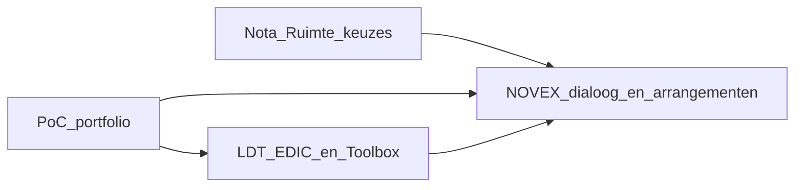

# Plan van aanpak — PoCs × Ontwerp-Nota Ruimte × NOVEX-provincies

| | |
|---|---|
| **Status** | Concept voor bespreking |
| **Datum** | 25 oktober 2026 |
| **Vorm** | Hybride: bestuurlijke kern (deel A) + technische bijlage (deel B) |
| **Beleidsanker** | Alleen publieke Nota Ruimte- en NOVEX-bronnen (zie hieronder) — **niet** het interne BZK-document Digitale ketenintegratie |
| **Doel** | PoC-portfolio, LDT EDIC en EU LDT Toolbox laten aansluiten op nationale ruimtelijke keuzes en de herijkte provincie-aanpak |
| **Leitmotif** | AI verkent · rekenlaag toetst · mens beslist |

---

## Beleidsbronnen (alleen websites)

| Bron | Wat we eruit gebruiken |
|---|---|
| [Ontwerp-Nota Ruimte (webversie)](https://www.rijksoverheid.nl/documenten/2025/09/26/ontwerp-nota-ruimte-webversie) | Langetermijnvisie; keuzes voor **2030** en **2050**, doorkijk **2100** |
| [Kamerbericht 26-09-2025](https://www.rijksoverheid.nl/actueel/nieuws/2025/09/26/kabinet-stelt-nationale-omgevingsvisie-op-en-maakt-keuzes-ontwerp-nota-ruimte-naar-tweede-kamer) | Vier thema’s; VISTA; woningbouwlocaties; energie; landbouw/natuur; water/bodem; regierol Rijk |
| [Aanpak provincies (NOVEX)](https://www.ruimtelijkeordening.nl/onderwerpen/novex/aanpak-provincies) | Startpakket → ruimtelijke voorstellen → **12 ruimtelijke arrangementen**; jaarlijkse actualisatie |
| [Herijking werkwijze NOVEX-provincies (2026)](https://www.ruimtelijkeordening.nl/documenten/2026/07/07/rapport-herijking-werkwijze-novex-provincies) | Doorlopende strategische dialoog; compactere arrangementen; betere aansluiting op Nota Ruimte en POVI’s |

### Portfolio-anker (techniek / EU)

| Bron | Rol |
|---|---|
| [EU_ROADMAP_ALIGNMENT.md](EU_ROADMAP_ALIGNMENT.md) | PoCs ↔ LDT Toolbox / D05.04 |
| [nldt/21-europai-edic-handover.md](../nldt/21-europai-edic-handover.md) · [edic-asset-map.json](../nldt/recipes/edic-asset-map.json) | EDIC-landing |
| [POC_REGELRECHT_INTEGRATION.md](POC_REGELRECHT_INTEGRATION.md) · [POC_DSO_REGELRECHT_BESTUURLIJKE_NOTITIE.md](POC_DSO_REGELRECHT_BESTUURLIJKE_NOTITIE.md) | Uitvoerbare regels + DSO-annotatie (ondersteunend, geen beleidsbron) |

---

# Deel A — Bestuurlijke kern

## A1. Probleem

De Ontwerp-Nota Ruimte stelt: ruimte is schaars; woningbouw, bereikbaarheid, energie, defensie, economie, landbouw, natuur, water en bodem vragen om **samenhangende nationale keuzes**. Het Rijk neemt regie, maar kan dat niet alleen.

NOVEX-provincies is het spoor waarin Rijk en provincies die keuzes **per provincie** vertalen: van startpakket en ruimtelijke voorstellen naar **wederkerige afspraken in ruimtelijke arrangementen**, die **jaarlijks** worden geactualiseerd. De herijking 2026 verschuift van eenmalige producten naar een **doorlopende strategische dialoog** met **integrale afwegingen** (waar opgaven elkaar raken) en **compactere arrangementen**, beter passend op de Nota Ruimte en provinciale omgevingsvisies.

Zonder deelbaar, herleidbaar ruimtelijk en juridisch feitenbeeld blijft die dialoog narratief. De PoCs leveren dat beeld — **niet** als besluit, **niet** als parallel stelsel.

## A2. Kernstelling

1. **Nota Ruimte** = nationale koers (2030 / 2050 / 2100).  
2. **NOVEX-provincies** = doorlopende dialoog + compacte, jaarlijkse arrangementen.  
3. **PoCs** = arrangement-klare evidence (zones, conflicten, scenario’s, coverage/onthouding).  
4. **LDT EDIC + Toolbox** = EU-hergebruik van dezelfde patronen (schaal, niet nationale regie).

## A3. Wat de websites inhoudelijk vragen (samenvatting)

### Ontwerp-Nota Ruimte — vier thema’s

| Thema | Richting uit het kamerbericht | PoC-haak |
|---|---|---|
| **Wonen, werken, bereikbaarheid** | VISTA (versterken, initiëren, stimuleren, transformeren, accommoderen); grootschalige woningbouwlocaties; knooppunten | Eindhoven (Accommoderen), Breda, MiniGIM, NSPD-context |
| **Economie en energie** | Schaarste bedrijvigheid; prioriteit energie-infra; clusters van nationaal belang; Noordzee-afweging | Utrecht wind/zon; NSPD haven/industrie |
| **Landbouw en natuur** | Zorgvuldig met landbouwgrond; robuuste natuur; balans in drukgebieden | Utrecht zoekgebied nieuwe natuur + conflict met energie |
| **Water en bodem** | Waterveiligheid, zoetwater, ruimte voor groen/wateropvang | Rijnland peil + grondwater-twin |

### NOVEX-provincies — werkwijze

| Element | Betekenis voor dit plan |
|---|---|
| 12 ruimtelijke arrangementen | Wederkerige Rijk–provincie-afspraken over inpassing nationale én regionale opgaven |
| Jaarlijkse cyclus | PoC-evidence moet **herhaalbaar** en **actualiseerbaar** zijn |
| Doorlopende dialoog (herijking 2026) | Minder “eindproduct-pilot”, meer structureel dialoogproduct |
| Integrale afweging | Crosstrack/conflictkaarten zijn kernlevering (niet single-issue kaarten alleen) |
| Aansluiting Nota + POVI | Labels en scenario’s expliciet aan Nota-thema’s koppelen |
| NOVEX-gebieden (apart spoor) | Optioneel later; dit plan focust op **provincie-aanpak** |

## A4. Rolverdeling

| Actor | Rol t.o.v. dit plan |
|---|---|
| Rijk (VRO e.a.) | Nota-keuzes; NOVEX-partner in arrangementen |
| Provincies | POVI + arrangement-partner; primaire afnemer van provinciaal evidence (Utrecht-patroon) |
| Gemeenten / waterschappen | Uitvoering en lokale instrumenten; PoC-partners (Eindhoven, Breda, Rijnland) |
| PoC / nLDT | Referentie-implementatie + herhaalbare evidence |
| LDT CitiVERSE EDIC + Toolbox | EU-adoptie en hergebruik van recipes/agents |

## A5. PoCs gegroepeerd op Nota-thema’s

### Wonen, werken, bereikbaarheid (VISTA)

| Asset | Bijdrage aan dialoog / arrangement |
|---|---|
| **PoC-2 Eindhoven** | Omgevingsplan-conversie met HITL — relevant waar Nota “Accommoderen” (sterke groei, o.a. Eindhoven) vraagt om snellere, controleerbare planactualisatie |
| **PoC-4 Breda** | Vijfwaarden-scan per buurt — leefkwaliteit naast woningbouwdruk |
| **PoC-5 MiniGIM** | Omgevingsanalyse volgens sectorpraktijk — snellere gebiedsvoorbereiding |

### Economie en energie

| Asset | Bijdrage |
|---|---|
| **PoC-1 Utrecht** (wind, zon, …) | Citeerbare “waar mag wat?”-zones voor provinciale inpassing energie |
| **PoC-NSPD** | Cross-border NL\|BE haven/industrie — patroon voor grensregio’s en nationale clusters |

### Landbouw en natuur

| Asset | Bijdrage |
|---|---|
| **PoC-1 Utrecht** (bos / nieuwe natuur) + **crosstrack** | Meetbaar conflict energie × natuurzoekgebied — typische NOVEX-integrale afweging |

### Water en bodem

| Asset | Bijdrage |
|---|---|
| **PoC-3 / PoC-6 Rijnland** | Formeel vs. operationeel peil; voorspellende grondwater-twin — waterschap als arrangement-partner |

### Dwars: toetsbaarheid

| Asset | Bijdrage |
|---|---|
| RegelRecht + DSO-overlap | Annotatie (welke regels hier?) → toets (formaliseerbare subset) → verkenning (AI) → mens beslist — voorkomt schijnzekerheid in scenario’s |

## A6. NOVEX-haak: wat “arrangement-klare evidence” is

Voor de jaarlijkse actualisatie van een ruimtelijk arrangement leveren PoCs:

1. **Citeerbare ruimtelijke outcomes** — zones met letterlijk artikel + instrumentversie.  
2. **Integrale conflictbeelden** — km² waar Nota-thema’s op dezelfde grond botsen.  
3. **Scenario-delta’s** — “wat als deze hendel anders?” herhaalbaar.  
4. **Coverage / onthouding** — waar de machine mag toetsen en waar de mens moet wegen.

**Belofte:** in de Rijk–provincie-dialoog ligt een gedeeld feiten- en regelbeeld vóórdat de arrangementstekst dichtgaat.  
**Geen belofte:** dat de twin of AI het arrangement schrijft of een vergunning afgeeft.

## A7. Twee starttracés

| Tracé | Beleidshaak | Product |
|---|---|---|
| **A — Gemeente in groeiregio (Eindhoven)** | Nota: VISTA Accommoderen / woningbouw | [RUNBOOK_NOTA_EINDHOVEN.md](RUNBOOK_NOTA_EINDHOVEN.md) — annotatie→toets→scenario |
| **B — Provinciaal arrangement (Utrecht)** | Nota: energie × natuur; NOVEX-dialoog | [RUNBOOK_NOVEX_UTRECHT.md](RUNBOOK_NOVEX_UTRECHT.md) + [NOVEX_ARRANGEMENT_MEMO_UTRECHT.md](NOVEX_ARRANGEMENT_MEMO_UTRECHT.md) |

## A8. Wat we níet doen

- Beleid baseren op interne stelselarchitectuurdocumenten buiten de genoemde websites.  
- Claimen dat PoCs nationale regie of DSO vervangen.  
- AI laten “beslissen” in arrangement of vergunning.

---

# Deel B — Technische bijlage

## B1. Mappingmatrix (Nota × NOVEX × EDIC × Toolbox)

| PoC | Nota-thema | NOVEX-rol | EDIC (richting) | Toolbox (richting) | Readiness | Gat |
|---|---|---|---|---|---|---|
| Utrecht | economie_energie, landbouw_natuur | arrangement_evidence | CitiVERSE recipes | Processes, Play & Visualise | live | netcongestie niet in beeld |
| Eindhoven | wonen | gemeentelijke_uitvoering | CitiVERSE bp2op | Identity, Processes | live | — |
| Breda | wonen | adoptie_narratief | CitiVERSE five-value | Records, P&V | live | — |
| MiniGIM | wonen | adoptie_narratief | CitiVERSE checklist | — | live | veel manual bindings |
| Rijnland ×2 | water_bodem | waterschap_partner | CitiVERSE peil/GWT | Processes | live/hybrid | — |
| NSPD | economie_energie | cross_border_patroon | CitiVERSE + IMPACTS | Features, P&V | live | BE-onderhoud |
| RegelRecht/DSO | dwars | toetsbaarheid_dialoog | IMPACTS trust | Processes | hybrid | lokale OV/OP in corpus |
| nLDT / Toolbox-sim | dwars | eu_schaal | alle EDICs | 20 BB | hybrid | utilisation-KPI |

## B2. LDT EDIC en Toolbox

| EDIC | Levering t.o.v. Nota/NOVEX |
|---|---|
| **LDT CitiVERSE** | Spatial recipes en city-evidence die Nota-thema’s operationaliseren |
| **IMPACTS** | Trust (V0–V4), marketplace, dataspace-patronen — dialoogproducten weerbaar maken |
| **Digital Commons** | Open broncode voor hergebruik door provincies/gemeenten |

Machine-readable labels: `policyAlignment` in [`nldt/recipes/edic-asset-map.json`](../nldt/recipes/edic-asset-map.json) — velden `nota_thema`, `novex_rol` (geen interne keten-roadmap).

## B3. Negentig-dagen acties

- [x] Plan + [2-pager](PLAN_NOVEX_NOTA_RUIMTE_2PAGER.md) op alleen Nota/NOVEX-websites.  
- [x] Eindhoven-runbook (Nota wonen / Accommoderen).  
- [x] Utrecht NOVEX-runbook + arrangement-memo met canonieke crosstrack.  
- [x] EDIC-assetmap getagd op Nota/NOVEX.  
- [x] [Gap-register](GAP_REGISTER_NOVEX_NOTA_RUIMTE.md).  
- [ ] Stakeholder-sessie provincie / NOVEX met arrangement-memo.  
- [ ] Stakeholder-sessie gemeente Eindhoven (of vergelijkbare groeiregio) met runbook A.

## B4. Zelfcheck

| Eis uit websites | Gedekt? |
|---|---|
| Nota-thema wonen/werken/bereikbaarheid | Eindhoven, Breda, MiniGIM |
| Nota-thema economie/energie | Utrecht, NSPD |
| Nota-thema landbouw/natuur | Utrecht bos + crosstrack |
| Nota-thema water/bodem | Rijnland |
| NOVEX doorlopende dialoog / jaarlijkse arrangementen | Memo + herhaalbare runs |
| Integrale afweging (herijking) | Crosstrack energie×natuur |
| LDT EDIC / Toolbox | §B2 + EU_ROADMAP |

---

## Gerelateerde documenten

- [PLAN_NOVEX_NOTA_RUIMTE_2PAGER.md](PLAN_NOVEX_NOTA_RUIMTE_2PAGER.md)  
- [RUNBOOK_NOTA_EINDHOVEN.md](RUNBOOK_NOTA_EINDHOVEN.md)  
- [RUNBOOK_NOVEX_UTRECHT.md](RUNBOOK_NOVEX_UTRECHT.md)  
- [NOVEX_ARRANGEMENT_MEMO_UTRECHT.md](NOVEX_ARRANGEMENT_MEMO_UTRECHT.md)  
- [GAP_REGISTER_NOVEX_NOTA_RUIMTE.md](GAP_REGISTER_NOVEX_NOTA_RUIMTE.md)  
- [EU_ROADMAP_ALIGNMENT.md](EU_ROADMAP_ALIGNMENT.md) · [POC_BESTUURLIJKE_SAMENVATTING.md](POC_BESTUURLIJKE_SAMENVATTING.md)
