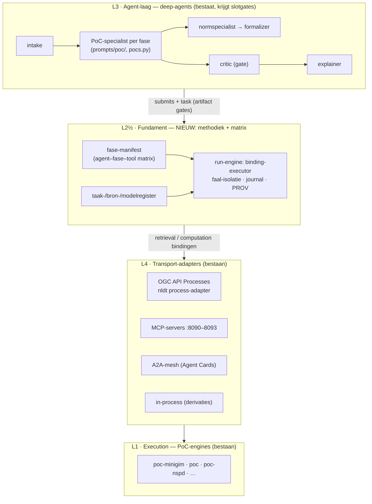

# Ontwerp: PoC-fundament met MiniGIM-harnas — de agent–fase–tool matrix

| | |
|---|---|
| **Datum** | 18 oktober 2026 |
| **Status** | ter review (architectuurfase — nog geen code) |
| **Vraag** | "Maak een nieuw fundament voor PoC's, met een harnas gebaseerd op de MiniGIM-aanpak: per agent weten in welke fase welke tool nodig is — informatie ophalen of een rekenmodel aanroepen." |
| **Verwijzingen** | [`docs/MINIGIM.md`](../../MINIGIM.md) + [`poc-minigim/`](../../../poc-minigim/) (methodiek, erfgoed) · [`MULTI_AGENT_PLAN.md`](../../../MULTI_AGENT_PLAN.md) (agent-roster, V0–V4) · [`a2a-simulation/architectuur-llm-gedreven-deepagents-met-deterministische-rekentools.md`](../../../a2a-simulation/architectuur-llm-gedreven-deepagents-met-deterministische-rekentools.md) (LLM rekent nooit zelf) · [2026-10-06 harness-unificatie](2026-10-06-utrecht-harness-unificatie-design.md) (vier lagen: surface → planningvlak → operations → execution harness) · [2026-10-18 utrecht-nspd-refactor](2026-10-18-utrecht-nspd-refactor-design.md) (declaratieve tracks) · EU LDT Toolbox D05.02 (`docs/public report on the ldt toolbox detailed specifications-KK0923368ENN.pdf`, BB02/04/06/12/13/15) · [`nldt/04-recipes-and-processes.md`](../../../nldt/04-recipes-and-processes.md) (AppStore → Cookbook → Cook) |
| **Buiten scope** | implementatie zelf (volgt als plan na review) · migratie van bestaande PoC's (die blijven staan) · GREX/IFC-export inhoud (fase-2-haken, blijft haak) · modelkeuze/-routing (laya blijft zoals hij is) |

---

## 1. Doel en succescriterium

De repo telt zeven PoC's (`poc`, `poc-breda`, `poc-rijnland`, `poc-minigim`,
`poc-bp2op`, `poc-nspd`, `poc-rijnland-gwt`), elk met een eigen harnas:
eigen runner, eigen bronregister, eigen validatie — dezelfde deugden
(deterministisch, PROV, V0–V4, cite-or-abstain) maar telkens opnieuw
geïmplementeerd. De harness-unificatie (2026-10-06) verenigde de *agent*-kant
(deep-agents = brein, nldt = execution harness); wat ontbreekt is een
**methodiek-laag**: een gedeeld fundament dat vastlegt *wat* een PoC doet —
in welke **fasen**, door welke **agent**, met welke **tools**.

Dat methodiek-antwoord ligt er al: de **MiniGIM-aanpak** (minigim.nl,
DMI-ecosysteem/NEPROM). PoC-5 bewees hem deterministisch: een checklist in een
register (Lijst v0.91), per item een expliciete binding `auto`/`partial`/
`manual` naar een tool, faal-isolatie met `manualPointer` in plaats van
gefakete delivery, PROV + V0–V3 met V4 (mens) pending by design. Dit ontwerp
generaliseert dat patroon tot het fundament voor élk PoC: de **harnas** is een
declaratieve **agent–fase–tool matrix** — per fase: welke agent, en per agent:
welke tools voor *informatie ophalen* (retrieval) of *rekenmodel aanroepen*
(computation) — die zowel (a) door mensen gelezen, (b) door de runtime
afgedwongen (slotgates) en (c) door tests geverifieerd kan worden.

**Succescriterium.** Een nieuw PoC schrijft voortaan alleen nog:
1. een **fase-manifest** (de matrix: fasen × agents × tools × bindingen × gates),
2. **register-invoer** (bronnen in het bronregister, rekenmodellen in het
   modelregister, checklist-taken in het taakregister),
3. golden-fixtures per fase.

De rest is fundament: de run-engine voert de bindingen deterministisch uit
(cache-first, faal-isolatie, PROV, V0–V4), de deep-agents-laag geeft elke
agent exact de tools van zijn fase (slotgate), en het rapport toont de matrix
inclusief wat *niet* automatisch kon (manual-pointer, nooit gefaked). Als
bewijs wordt het bestaande `poc-minigim` als eerste PoC op het fundament
gezet zonder dat de pilot-uitkomsten (29/74 delivered, byte-identieke
artefacten) veranderen.

## 2. Wat "harnas gebaseerd op de MiniGIM-aanpak" betekent

Zes erfgoed-principes uit PoC-5 die het fundament overneemt en generaliseert:

| # | MiniGIM-principe (PoC-5) | Generalisatie in het fundament |
|---|---|---|
| 1 | Checklist-gedreven: de 74 Lijst-items staan in een register, niet in code | Elke PoC declareert zijn methodiek als **fase-manifest** (JSON, schema-gevalideerd), niet in een runner |
| 2 | Expliciete bindingen per item: `auto` (14) / `partial` (15) / `manual` (45) | Elke taak in elke fase krijgt een binding naar één tool of een menselijke pointer — nooit impliciet |
| 3 | Faal-isolatie, geen fake delivery: item → `not-delivered` + risicovlag + `manualPointer` | Fase-resultaten zijn per taak `delivered`/`partial`/`not-delivered`; een toolstoring degradeert, breekt of vervalst nooit |
| 4 | Geen LLM in de beslislijn | Retrieval en computation zijn altijd deterministisch; LLM-agents specificeren en interpreteren alleen (a2a-architectuurregel: *LLM specificeert → tool rekent → LLM interpreteert*) |
| 5 | PROV (sha256, fetch-manifesten) + V0–V3, V4 pending by design | Elke tool-aanroep levert provenance; validatie is een fase-gate, geen nazorg |
| 6 | Bronnen gepind met quirks (`sources.json`), server-caps zichtbaar (`layerCapped`) | Bronregister en modelregister met versie-pins, quirks en capaciteitsnotities — verplicht veld |

## 3. Kernconcepten (het woordenboek van het fundament)

| Concept | Betekenis | MiniGIM-herkomst |
|---|---|---|
| **Methodiek** | de gedegenereerde route die een PoC aflegt; de reeks fasen uit het manifest | de MiniGIM-werkwijze: omgevingsanalyse → gebiedsindeling → (fase 2) doorrekening |
| **Fase** | een scheiding in de methodiek met eigen agent(s), tools, taak-lijst, **gate** (exit-criterium) en artefacten | Lijst-fase vs. ILS-fase |
| **Taak** | één checklist-item binnen een fase, met binding en status | één Lijst-item (74 stuks) |
| **Agent** | de verantwoordelijke rol voor een fase: een LLM-agent (deep-agents-specialist) of een deterministische specialist (engine-module) | PoC-5-runner had alle rollen implicit in één script; nu expliciet |
| **Tool** | een aanroepbare eenheid met schema, provenance en transport; twee werkpaarden: **retrieval** (informatie ophalen uit bronregistraties/corpora) en **computation** (rekenmodel), naast `validation` en `report` | de derivation-ops (`clip_layer`, `count_in_aoi`, `proxy_ratio`, …) |
| **Binding** | `auto` / `partial` / `manual` per taak → tool of menselijke pointer | lijst-bindings.json (74/74) |
| **Gate** | het exit-criterium van een fase: V-levels, schema-gate, HITL-interrupt | V0–V3 exit-0, V4 pending |
| **Slotgate** | runtime-afdwinging: een agent ziet alleen de tools die het manifest aan zijn fase toekent | NSPD-slotgate-patroon, nu per fase |
| **Register** | taakregister (Lijst), bronregister (v2.0-stijl met `role`/`fetchPolicy`/quirks), modelregister (rekenmodellen: processId/AgentCard/parameters/versie-pin/riskLevel) | minigim-lijst.json · data/sources.json · BB13 Model Catalogue |
| **Run** | één uitvoering: journal + PROV + fase-artefacten + validatieverdict | runs/<ts>-minigim-gebiedscheck/ |

## 4. Architectuur: vier lagen op de bestaande unificatie

Het fundament vult de methodiek-laag in die de harness-unificatie openliet —
de lagen eronder bestaan al en worden niet opnieuw gebouwd:



| Laag | Wat | Bestaat al? |
|---|---|---|
| **L3 Agent-laag** (brein) | deep-agents: per fase een agent met de tools die het manifest toekent (slotgate); artifact gates (`submit_*`), HITL-interrupts, journal, laya-routing | ✅ — uitbreiding: fase-bewustzijn via manifest |
| **L2½ Fundament** (methodiek) | `poc-fundament/`: manifest-schema's, taak-/bron-/modelregisters, binding-executor (retrieval/computation), fase-gates, matrix-renderer | ❌ — dit ontwerp |
| **L4 Transport** | OGC API Processes (nldt Cookbook→Cook), MCP-servers, A2A Agent Cards, in-process derivaties | ✅ |
| **L1 Execution** | de PoC-engines zelf (authoritatief, met eigen V0–V4) | ✅ — blijven staan |

**Ontwerpregel blijft de unificatie-lijn:** de agent vraagt, het fundament
executeert, de harness (nldt) bewaakt credentials/gates/risicotiers. Het
fundament voegt alleen toe *welke* tools bij *welke fase* horen en *hoe* hun
bindingen geëxecuteerd en bewezen worden.

## 5. Het hart: de agent–fase–tool matrix (fase-manifest)

Per PoC één `manifest.json`, gevalideerd tegen `fundament/fase-manifest.schema.json`.
Vorm (verkleind voorbeeld, de MiniGIM-invulling staat in §8):

```jsonc
{
  "poc": "minigim-gebiedscheck",
  "methodiek": "minigim-v0.91",          // herkenbare methodiek-pin
  "aoi": { "schema": "geojson", "crs": "EPSG:28992|WGS84" },
  "phases": [
    {
      "id": "F1-omgevingsanalyse",
      "title": "Omgevingsanalyse (informatie ophalen)",
      "agent": { "role": "poc-specialist", "llm": false },   // deterministische fase
      "tasks": [
        {
          "id": "bgt-terrein", "from": "register:minigim-lijst",
          "binding": "auto",
          "tool": { "class": "retrieval", "ref": "pdok:bgt/objecten",
                    "transport": "processes", "derive": ["clip_layer", "historical_filter"] }
        },
        { "id": "woz-buurtniveau", "binding": "partial",
          "tool": { "class": "retrieval", "ref": "pdok:wfs:cbs-wijken-buurten",
                    "derive": ["proxy_ratio"] },
          "notes": "proxyNote verplicht — buurtniveau → plangrens" },
        { "id": "bodem-verontreiniging", "binding": "manual",
          "manualPointer": { "bron": "Omgevingsloket/RO-online", "grondslag": "…" } }
      ],
      "gate": { "validate": ["V0", "V2"], "onFail": "degradeer-taak" }
    },
    {
      "id": "F3-doorrekening",
      "title": "Doorrekening (rekenmodel aanroepen)",
      "agent": { "role": "poc-specialist", "llm": false },
      "tasks": [
        { "id": "fsi-proxy", "binding": "auto",
          "tool": { "class": "computation", "ref": "model:gebiedsmix",
                    "transport": "in-process", "prov": "params+versie" } },
        { "id": "grex-financieel", "binding": "manual",
          "manualPointer": { "bron": "GREX-tabellen fase 2", "status": "fase-2-haak" } }
      ],
      "gate": { "validate": ["V3"], "hitl": "variant-keuze" }
    }
  ]
}
```

**Velden die het harnas zijn** — elk veld heeft een lezer en een afdwinger:

| Veld | Gelezen door | Afgedwongen door |
|---|---|---|
| `phases[].agent` | `deep-agents/pocs.py` (specialist-build), laya (route → fase-agent) | slotgate-middleware: agent krijgt alleen fase-tools |
| `tasks[].binding` | run-engine (executeer / degradeer), matrix-renderer (README + rapport) | V2: elke `auto`-binding moet bron-gegrond zijn; `manual` zonder pointer = manifest-fout |
| `tasks[].tool.class` | run-engine (retrieval-pad vs. computation-pad) | contracttests per klasse (retrieval: fetch-manifest; computation: params+versie in PROV) |
| `tasks[].tool.transport` | transport-adapters (L4) | riskLevel-tiering (nldt): high → `needs_human` |
| `phases[].gate` | run-engine (V-levels), HITL-queue | exit-criterium: fase eindigt niet zonder gate-verdict |

## 6. Fase-archetypen voor een generiek PoC

MiniGIM generaliseert tot vijf archetypen; een PoC kiest, herhaalt of laat
vallen — de architectuur schrijft geen vast aantal fasen voor, wél dat elke
fase een agent, taak-bindingen en een gate heeft:

| archetype | vraag | agent (typisch) | tool-klasse (typisch) | gate (typisch) |
|---|---|---|---|---|
| **F0 intake/scoping** | wat is de vraag, wat het gebied? | intake (LLM) + laya | validation (schema-gate op request) | schema-pass |
| **F1 omgevingsanalyse** | wat weten we uit bronregistraties? | PoC-specialist (deterministisch), normspecialist (corpus) | **retrieval** (OGC API/WFS/records, normcorpus) | V0+V2 |
| **F2 gebiedsindeling/alternatieven** | hoe delen we het gebied/welke varianten? | geospecialist + scenario-analist (LLM stelt voor) | retrieval + derivation | V1 + **HITL** (draft → mens kiest) |
| **F3 doorrekening** | wat zeggen de modellen? | PoC-specialist; rekenblok nooit LLM | **computation** (processes/A2A/in-process) | V3 (replay) |
| **F4 synthese & rapport** | wat betekent het, waarom? | critic (gate) + explainer | validation + report | V0–V4-verdict, exit 0 alleen bij pass |

Twee herhalingen van de MiniGIM-moraal over de hele lijn: (1) **getallen
komen altijd uit een tool** — de LLM-agents van F0/F2/F4 zijn nooit de bron
van een waarde; (2) **V4 is pending by design** — de checklist/ILS/draft is
invoer voor de professional, geen eindoordeel.

## 7. Alternatieven en keuze

| optie | inhoud | oordeel |
|---|---|---|
| **A. Apart fundament-package `poc-fundament/` + per-PoC manifest** (gekozen) | Methodiek, registers en binding-executor als gedeelde package (generalisatie van `poc-minigim/minigim/`); deep-agents leest het manifest voor slotgates; nldt blijft execution harness; PoC-engines blijven authoritatief | past bij de unificatie-lijn (brein ≠ harness ≠ methodiek); deterministische kern blijft LLM-vrij en offline-testbaar; herbruikt de bewezen MiniGIM-code (registry/fetch/validate/report) i.p.v. een vierde runner-fork; nadeel: één package meer om te onderhouden |
| **B. Fase/agent-metadata in nldt-recipes** | recipes uitbreiden met `phases[]` en per stap een agent-rol | dicht bij AppStore/Cookbook/Cook en BB06; maar recipes zijn platte stappenlijsten: bindingen (auto/partial/manual), faal-isolatie en matrix-rendering horen daar niet thuis, en de agent-kant (slotgates) zou dan in de adapter komen — governance-laag wordt methodiek-laag, dat is een te verwarren rol |
| **C. Manifest alleen in deep-agents** (subagent-config) | de matrix als deep-agents-configuratie | snelste weg naar slotgates, maar dan hangt de methodiek aan de LLM-stack: runs worden LLM-afhankelijk en de deterministische runner kan het manifest niet zelf uitvoeren — strijdig met erfgoed-principe 4 |

Aanbeveling: **A**, met de integratie-punten uit beide alternatieven als
bruggen (recipes kunnen per fase een `processId` dragen — L4; deep-agents
leest het manifest — L3). Concreet: `poc-fundament/` bevat het schema, de
registers- loaders, de binding-executor en de matrix-renderer; `poc-minigim`
wordt de eerste consument (§8) en levert zo meteen het bewijs dat PoC-5's
pilots byte-identiek reproduceerbaar blijven.

## 8. Eerste invulling: MiniGIM-gebiedscheck als manifest

De bestaande PoC-5-fakten, als matrix uitgedrukt (verkorte weergave; de
volledige 74 items blijven in het taakregister):

| fase | agent | retrieval-tools (informatie ophalen) | computation-tools (rekenmodel) | gate |
|---|---|---|---|---|
| F0 intake | intake (LLM) + laya | — | OpportunityMapRequest-gate | schema-pass |
| F1 omgevingsanalyse | minigim-specialist (deterministisch) | PDOK OGC API (BGT/BRK/Natura 2000/NWB/RCE; cursor-paginering), PDOK WFS (BAG, CBS), geo.breda.nl MapServer (`where=1=1`, `layerCapped` bij cap ~1000) | derivaties: `clip_layer`, `clip_stats`, `count_in_aoi`, `list_in_aoi`, `presence`, `proxy_ratio`, `proxy_entropy`, `historical_filter` | V0+V2; faal-isolatie per item |
| F2 gebiedsindeling | geospecialist (deterministisch classifier) | BGT/BAG/BRK-feature-sets | ILS-registry-mapping (`ils.py`: wegen→IFCROAD, water→IFCSITE, …), `epsetMinigim`-afleiding | V1; `draft: true` + **HITL V4** |
| F3 doorrekening | minigim-specialist | — | `fsiProxy`/`gsiProxy`/`mxiProxy` (entropy, in-process); GREX-financiën = `manualPointer` (fase-2-haak, later A2A Agent Card) | V3 replay |
| F4 synthese & rapport | critic + explainer | prov-lookup | validators V0–V3, report-renderer | verdict `pass` → exit 0 |

Dit is exact het gedrag van de pilot (29/74 delivered, 45 manual-action,
3/11 hoog-prioriteit-auto) — alleen declaratief in plaats van gebakken in
`run.py`.

## 9. Validatie: V0–V4 + harnas-tests

De V-levels van het multi-agent plan (§4 daar) worden fase-gates en krijgen
een tool-contract-variant erbij:

| level | check | executor in het fundament |
|---|---|---|
| V0 | schema-validiteit (manifest, registers, artefacten) | jsonschema, deterministisch |
| V1 | geometrie (geldigheid, CRS, plangrens-sanity) | shapely/postgis-pad, deterministisch |
| V2 | bron-gronding: elke `auto`-binding herkenbaar in de PROV van het resultaat; elke `manual`-taak heeft pointer | deterministisch (prov-vergelijk) |
| V3 | in-run replay: derivaties en computations herberekend, byte-vergeleken | deterministisch |
| V4 | menselijke toets (draft-keuze, verdict) | HITL-interrupt (deep-agents checkpointer + verdict-ledger, bestaand patroon) |
| **V-tool** (nieuw, test-tijd) | contracttest per tool-binding: mock/replay-fetch voor retrieval, param+versie-replay voor computation; slotgate-test: agent ziet uitsluitend fase-tools | offline unittest-suite, golden-runs per fase |

Harnas in de testbetekenis: golden-fixtures per fase (cache-first, geen
netwerk), regressie op matrix-rendering, en een manifest-conformance-test
(elke fase ≥1 agent, elke taak binding+toolRef-of-pointer, elke gate bekend).

## 10. Integratie met bestaande onderdelen

| onderdeel | koppeling |
|---|---|
| `deep-agents/` | `pocs.py` bouwt per manifest-fase een specialist (prompt-skelet uit `prompts/poc/*.md`); slotgate-middleware koppelt exact de fase-tools; artifact gates (`submit_*`) blijven; laya routeert request → (poc, fase-agent); HITL-verdicts via bestaande checkpointer/ledger |
| `nldt/` | per computation-tool een recipe/processId (Cookbook→Cook); riskLevel-tiering blijft de execution-harness-laag; AppStore-catalog-index leest het modelregister voor discovery |
| `a2a-simulation/` | Agent Card per extern rekenmodel (BB15-patroon): deterministisch rekenblok als A2A-agent; `catalog/poc-agents.json` krijgt per PoC de fase-lijst uit het manifest |
| viewer (Leia/NSPD-patroon) | fase-artefacten worden lagen in de bestaande config-generatie; matrix-tabel komt in het run-rapport (report.html-patroon van PoC-5) |
| EU LDT Toolbox (D05.02) | alignment: BB02 Case & Scenario Manager ↔ manifest/runs · BB04 Data Query Service ↔ retrieval-tools + bronregister · BB06 Data Workflow & Orchestration ↔ fase-gates/binding-executor · BB12 Model Abstraction ↔ transport-adapters · BB13 Model Catalogue ↔ modelregister · BB14 Model usage guidelines ↔ per-tool quirks/risico-notities · BB15 Algorithms & Models ↔ computation-tools |
| `planning_indicators/` | blijft additieve referentielens (bestaand patroon); taakregister kan er lens-items uit citeren |

## 11. Mijlpalen (na goedkeuring van dit ontwerp)

| mijlpaal | inhoud | exit |
|---|---|---|
| **M1 — schema's + registers** | `poc-fundament/` package: `fase-manifest.schema.json`, register-loaders (taak/bron/model), matrix-renderer; manifest van PoC-5 als eerste exemplaar (gegenereerd uit de bestaande bindings, handmatig nagelopen) | manifest + registers schema-pass; matrix-tabel klopt op item-niveau met PoC-5-werkelijkheid |
| **M2 — binding-executor** | generalized `fetch`/`derive`/`compute`, ontleend aan `poc-minigim/minigim/` (strategie: zie beslispunt 2 in §13) | PoC-5-pilot draait via het fundament: artefacten byte-identiek, V0–V3-verdict gelijk |
| **M3 — slotgates in deep-agents** | middleware leest manifest; per-fase-specialist; journal vermeldt fase + gate-verdicts | slotgate-test: agent buiten zijn fase heeft geen tools; volledige-keten-demo loopt ongewijzigd |
| **M4 — transport-bruggen** | computation-tool → processId (nldt) en Agent Card (a2a); riskLevel-tiering bewezen in een high-voorbeeld (HITL) | een extern rekenmodel aanroepbaar via beide transports mét PROV |
| **M5 — golden + docs** | V-tool-suite, golden-runs per fase, README-vorm (`poc-fundament/README.md` met de matrix als tabel), herdok van `docs/MINIGIM.md`-fase-2-haken naar het modelregister | nieuwe PoC volgens §1-succescriterium binnen één werkdag aanmeldbaar |

Elke mijlpaal is een eigen merge met eigen gate (geen big bang); M2 is het
bewijsmijlpaal en mag niet samen met M3/M4.

## 12. Risico's en beperkingen

| risico | mitigeren |
|---|---|
| Abstractie-druk: het fundament wordt een vierde runner-fork (net als agents.py eerder) | M2-byte-identiek-bewijs op PoC-5; PoC-engines blijven authoritatief — het fundament orkestreert, vervangt niets |
| Manifest-drift: code kan anders gaan doen dan de matrix belooft | V-tool-regressie + matrix-rendering in elke run (het rapport toont de matrix zoals daadwerkelijk gelopen) |
| Te vroege generalisatie uit één PoC | vijf fase-archetypen zijn bewust los; tweede PoC (kandidaat: NSPD-tracks of Utrecht) valideert pas na M2 |
| LLM-stack-koppeling sluipert toch in de kern | fundamentspackage mag deep-agents niet importeren (dependency-richting vast: L3 → L2½, nooit omgekeerd); afgedwongen in CI |
| Scope-creep naar GREX/IFC (fase 2) | blijft `manualPointer`/haak in het modelregister — niets nieuws geïmplementeerd |

## 13. Open beslispunten (met aanbeveling — vast te leggen in review)

1. **Naam/plaats**: `poc-fundament/` met package `fundament` (aanbevolen; groepeert bij poc-*, is zelf geen PoC). Alternatieven: `harnas/`, onderbrengen bij `nldt/services/`.
2. **M2-strategie**: generalized modules *trekken* uit `poc-minigim/minigim/` met terug-import door PoC-5 (aanbevolen: één bron van waarheid) vs. dependencie-loze kopie (sneller, drift-gevaar).
3. **Fase-recipes in nldt**: nu alleen per computation-tool een processId (aanbevolen) — losse recipes per fase is pas nuttig zodra meerdere PoC's dezelfde fase-ketens delen.
4. **Manifest-formaat**: JSON + jsonschema (aanbevolen, past bij bestaande schema-cultuur) vs. YAML voor menselijke leesbaarheid.
5. **Tweede pilot-PoC**: NSPD-tracks (rijker aan juridische bindingen) vs. Utrecht-na-de-refactor (sluit aan bij het refactorontwerp van vandaag) — beslissen ná M2.

---

*Volgende stap na review: implementatieplan (writing-plans) op basis van de
mijlpalen in §11, te beginnen met M1.*
