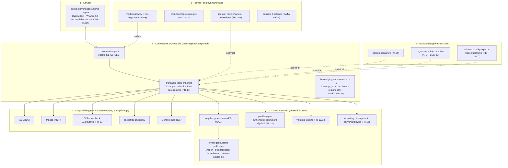

# Ontwerp — Piloot Gent: transactionele levensgebeurtenis-assistent (EUROPAI WP3)

| | |
|---|---|
| **Datum** | 30 oktober 2026 |
| **Status** | ter review (na keuzes uit sessie 2026-10-30) |
| **Scope** | uitgebreid ontwerp van de Gent-piloot: blauwdruk die de lege EUROPAI D3.1-secties (§2.3 architectuur, §2.4 afhankelijkheden, §4.x KPI/testen/risico's) ontwerpt én de basis voor een werkend prototype `poc-gent/` in dit repo, met gemockte Vlaamse diensten |
| **Niet in scope** | productie-integraties met echte ACM/IDM-, Magda-, GIS- of District09-systemen · echte persoonsgegevens · DPIA-uitvoering · M/O-prioritering per eis · definitieve transactiekeuze door Stad Gent · frontend-productie-widget |
| **Bronnen** | [`pilootgent/Gent pilot.pdf`](../../pilootgent/Gent pilot.pdf) (EUROPAI D3.1 Pilot Plans-template Stad Gent; tekstextract: `pilootgent/gent-pilot.txt`) · [HCS life-events](../../nldt/04-recipes-and-processes.md) (THK-recipes, `hcs-life-event-run`, G1–G5) · [`nldt/schemas/hcs-run.schema.json`](../../nldt/schemas/hcs-run.schema.json) · [HITL-ontwerp 2026-10-07](2026-10-07-hitl-mens-agent-grens-design.md) (interrupt_on, SqliteSaver, resume) · [`deep-agents/hcs_intake.py`](../../deep-agents/hcs_intake.py) (LLM-intake + deterministische gate) · [GENAI_SEAMS](../../docs/GENAI_SEAMS.md) · [edic-asset-map](../../nldt/recipes/edic-asset-map.json) (`assetClass: hcs-life-event`) |
| **Sessie-keuzes** | doel: **blauwdruk + repo-prototype** (geen alleen-papieren architectuur) · transactiekeuze: **generiek ontwerp, keuze open** — beslislogica als configuratie-artefact, met één vervangbaar referentiepakket voor aantoonbaarheid |

## Besluiten

| Keuze | Uitkomst |
|---|---|
| Ontwerpvorm | Eén ontwerpdoc dat D3.1 §2.3/§2.4/§4.x ontwerpt én de prototype-basis vormt (`poc-gent/`) |
| Transactiekeuze | Open: levensgebeurtenis-**pakketten** als data (recipe-formaat), geen gehardecodeerde flow; referentiepakket `gent-mobiliteit-ondernemer` ter demo/acceptatie, expliciet vervangbaar |
| Basispatroon | Uitbreiding van het HCS/THK-life-event-patroon uit dit repo (`nldt/recipes/thk-*.json`, `hcs-run.schema.json`, `hcs-life-event-run`) — geen nieuw pakketformaat |
| Join-key | `lifeEventCode` (The Key-codes hergebruikt waar ze bestaan: THK-08 verhuizen, THK-24 verbouwen; Gent-specifiek: `GT-`-namespace) over recipe ↔ baseline ↔ fixture ↔ run |
| Rolverdeling | *LLM stelt voor · engine beslist · mens bevestigt*: LLM alleen op gedefinieerde seams; regel-engine, GIS-check, prefill-mapping, validatie en inzending deterministisch; vijf bevestigingsmomenten H1–H5 |
| Orchestratie | deep-agents (bestaand): graph + `interrupt_on` voor consequentiële tools, SqliteSaver-checkpointer voor safe resume, journal als bewijslaag |
| Model | Governed model-gateway als enige LLM-toegangspunt; prototype offline: `--llm none|ollama|gateway` (repo-doctrine, geen key vereist); D3.1-hint Claude/Anthropic onder EU-verwerkersregeling is één invuloptie, geen ontwerpkeuze |
| Data | Geen echte persoonsgegevens in het prototype; personas/fixtures (naar THK-patroon); mocks voor ACM/IDM, Magda (MCP-vorm), GIS-zones, backoffice-ontvangstbewijs |

### Overwogen alternatieven

| Alternatief | Waarom niet |
|---|---|
| **B. LLM-georkestreerde assistent** (het model drijft de hele flow via tool-use) | Snel te demoën, maar faalt op FR-06 (goedgekeurde geversioneerde beslislogica), NFR-09 (regels/prompt/workflow scheidbaar van model/runtime), AI-04 (regressie bij modelwijziging) en auditbaarheid (SEC-04). De beslissing welke vergunning nodig is, mag niet afhangen van een modelrun. |
| **C. Klassieke formulieren-platform met LLM-chatboutage** | Veiligst, maar faalt op FR-03/FR-04 (vrije tekst, adaptieve contextvragen) en de kern van de pilotobjective (transactioneel, once-only). Escalatiebudget bij leveranciersPlatform past niet in de EUROPAI-replicatiedoelstelling (REP-01). |
| **Nieuw, Gent-eigen pakketformaat** | Uitvinden wat er al is: het THK/recipe-formaat, run-schema en intake-gate dekken vraagstuk, testbaarheid en EDIC-registratie al; een nieuw formaat verscheurt herbruikbaarheid (WP4-handover). |

## 1. Context en doel

Stad Gent is een EUROPAI-WP3-piloot (Grant 101298736). Het D3.1-pilootplan beschrijft een
**transactionele assistent** bij levensgebeurtenissen (verhuizen, verbouwen, evenementen
organiseren, herstelwerken als zelfstandige): gespreksgewijs context bepalen, beslislogica
toepassen, begeleiden naar de juiste diensten/vergunningen/transacties, prefillen volgens het
once-only-beginsel en na expliciete bevestiging indienen in de backofficesystemen — met ACM/IDM
(Digital Vlaanderen) als authenticatie, Magda als authentieke bron (in het plan zelf al
"Magda (MCP) services" genoemd), interne GIS-diensten voor zonechecks (LEZ, autovrij gebied) en
Gentinfo als menselijk escalatiekanaal.

In het template zijn §2.1 (workflow, 10 stappen) en §2.2 (eisencatalogus: FR-01…23, NFR-01…09,
DATA-01…07, INT-01…07, SEC-01…08, AI-01…08, REP-01…02, OPS-01…02) uitgewerkt; **§2.3
architectuur, §2.4 afhankelijkheden, §4.x KPI's/testen/risico's en §3.x rijpheid zijn leeg**.
Deze strategie noemt implementatie pas in 2028 en schuift een gedetailleerde nulmeting dan ook
terecht door; het prototype meet daarom eerst proxymaten (taakduur, aanraakmomenten,
nauwkeurigheid) en legt de meetmethode voor de latere nulmeting al vast.

Dit repo brengt de ontbrekende helft al mee: het HCS/THK-life-event-patroon (recipes met
`lifeEventCode`, personas, G1–G5-testpunten, baselines met stopcondities en go/no-go, run-schema
met mens-agent-grens en bronherkomst), de deep-agents-HITL-infrastructuur (interrupt, resume,
journal) en de intake-gate ("alleen vragen wat niet in de bron staat"). Het ontwerp verlengt dat
patroon tot aan de transactie: van intake tot ontvangstbewijs.

## 2. Leidende principes (eis → doctrine)

| Principe | Dekt | Uitwerking |
|---|---|---|
| LLM stelt voor, engine beslist, mens bevestigt | FR-13, FR-15, AI-02 | Het model verstaat, vraagt, vult voor en legt uit; de regel-engine bepaalt het pad; elke juridisch relevante stap wacht op expliciete bevestiging (H1–H5). Zwijgen is nooit toestemming (FR-15). |
| Cite-or-abstain | FR-07, DATA-01, AI-05 | Elke feitelijke uitspraak, regelevaluatie en prefill-waarde draagt bron (bron-id, versie, tijdstip) of de assistent onthoudt zich — de weigering wordt gelogd. |
| Configuratie is data | FR-22, NFR-09, REP-01 | Levensgebeurtenis-pakketten zijn geversioneerde JSON-artefacten in git (review = pull request, rollback = revert), exportsbaar en herbruikbaar door andere besturen. |
| Alles herreelbaar | SEC-04, FR-17, AI-04 | Elke run produceert een herreelbaar run-artefact + journal (hash-chained); regressie = deterministisch opnieuw afspelen. |
| Offline-first, geen echte persoonsgegevens | SEC-02/05, DATA-03/07 | Prototype draait keyless met fixtures en mocks; geen training op gemeentedata; journal maskeert identifiers. |
| Vrije uitweg | FR-02, FR-08, FR-20 | De assistent blokkeert niets: zonder assistent verder kan altijd, terug naar een eerdere stap kan zonder geldige bevestigde gegevens te verliezen, menselijke overname kan op elk moment. |

## 3. Architectuur (vult D3.1 §2.3)

Zes lagen; de pijlers "transactiekern" en "bewijslaag" zijn deterministisch.



**Kort:** de assistent is een gesprekslaag (LLM) boven een deterministische transactiekern die
zijn inhoud volledig uit geversioneerde pakketten haalt, via streng bewaakte adapters praat met
Vlaamse en gemeentelijke systemen, en elke run bewijsbaar vastlegt. De lagen 3, 5 en 6 zijn
onafhankelijk van het gekozen model en runtime leverbaar (NFR-09): het model zit alleen achter
seam S1–S5 en de gateway.

## 4. Levensgebeurtenis-pakketten (config = data)

Een pakket is een recipe in het bestaande formaat (`nldt/recipes/*.json`) met het bekende
`service`-blok (EDIC-anatomy: dish, parties, legalBasis, humanMeasure, genAiTestPoints, kpis)
**plus** een nieuw `transactionCatalog`-blok. Bestaande THK-recipes blijven ongewijzigd geldig.

```json
{
  "id": "gent-mobiliteit-ondernemer",
  "title": "GT-MOB-01 — Voertuigtoegang stadcentrum voor ondernemers",
  "version": "1.0.0",
  "status": "concept",
  "tags": ["hcs", "gent", "transactioneel", "GT-MOB-01"],
  "requiredProcesses": ["gent-transactional-run"],
  "service": {
    "dish": "the-key", "lifeEventCode": "GT-MOB-01",
    "serviceType": "reactive", "parties": [ {"name": "Stad Gent — mobiliteit", "role": "lead"}, {"name": "District09", "role": "backoffice"} ],
    "legalBasis": [ {"basis": "Gent LEZ-reglement / SE Ruimtelijke Ordening", "timeLimit": "beslistermijn volgens pakkegoedkeuring (illustratief)"} ],
    "humanMeasure": {"handover": ["twijfel aan zone/kenteken → medewerker"], "exceptions": ["mandaten", "collectief vervoer"]},
    "genAiTestPoints": [ {"point": "G1", "description": "intake vraagt alleen wat niet in Magda staat", "testCases": ["persona's, zie fixtures"]} ],
    "kpis": [ {"kpi": "routingnauwkeurigheid", "kpiType": "outcome", "unit": "%", "dataSource": "journal", "frequency": "per release"} ]
  },
  "transactionCatalog": {
    "contextSchema": {
      "slots": {
        "applicantType": {"enum": ["burger", "ondernemer", "organisatie"], "required": true},
        "address": {"type": "string", "gis": true, "required": true},
        "timing": {"type": "periode", "required": false},
        "vehicle": {"type": "kenteken", "authentic": "magda:kenteken", "required": false},
        "activity": {"type": "string", "required": true},
        "mandate": {"type": "referentie", "required": false}
      }
    },
    "gisChecks": [ {"id": "lez", "layer": "gent-lez", "input": "address", "output": "zoneLez"}, {"id": "autovrij", "layer": "gent-autovrij", "input": "address", "output": "zoneAutovrij"} ],
    "decisionTables": [ {"id": "R-toegang", "version": "2026.10", "rules": [ {"when": {"zoneLez": "in", "applicantType": "ondernemer"}, "then": {"transactions": ["ontheffing-lez"], "legalBasis": "LEZ-reglement art. …", "uitleg": "nl"} ], "unknownPolicy": "escalate"} ],
    "services": [ {"id": "ontheffing-lez", "type": "inzending", "formSchema": "formulieren/ontheffing-lez.schema.json", "documents": [ {"id": "kentekenbewijs", "verplicht": true} ], "backend": {"contract": "district09-vergunningen", "idempotent": true, "async": "polling"}, "timing": "per aanvraagperiode (illustratief)"} ],
    "authenticSources": [ {"slot": "vehicle", "source": "magda:kenteken", "purpose": "ontheffing beoordelen"} ],
    "texts": {"intro": "nl", "scope": "nl", "aiToelichting": "nl", "weigering": "nl", "escalatie": "nl"},
    "golden": "golden/scenarios.jsonl"
  },
  "cookbookUri": "http://localhost:8081/recipes/gent-mobiliteit-ondernemer"
}
```

Conventies:

- **`lifeEventCode` is dé join-key** over recipe ↔ baseline (`nldt/recipes/baselines/`) ↔ fixture
  (personas) ↔ run-artefact, zoals bij THK. Bestaande The Key-codes worden hergebruikt waar ze
  bestaan (verhuizen = THK-08, verbouwen = THK-24); Gent-specifieke events (mobiliteit
  ondernemers, evenementen) krijgen een `GT-`-code en worden in de koppeltabel
  (`docs/HCS_RECIPES_AGENTIC_STATE.md`) geregistreerd.
- **`unknownPolicy: escalate`**: beslistabellen kennen geen "gok"-tak; een niet-gedekte
  combinatie van contextwaarden leidt tot uitleg + H5-overname (AI-05) — nooit tot een
  afgeleid antwoord.
- **Personas** volgen het THK-fixturepatroon (`scenarioKind: life-event`, defaults +
  `perPersona`-overrides, nl/en-labels), inclusief edge-cases (lage geletterdheid, andere taal,
  mandaat/bewind) — die dragen direct aan NFR-06 en AI-08.
- **Status/version**: `concept → review → actief → ingetrokken`; goedkeuring en rollback via
  git/PR (FR-22); supersessie vastgelegd in de broncatalogus (DATA-02).

Het referentiepakket `gent-mobiliteit-ondernemer` is de uitwerking van het voorbeeld dat het
D3.1-plan zelf in §2.1 uitwerkt (kenteken, LEZ, autovrij gebied, ondernemer) en dient alléén als
aantoonbare verticale slice; het is één map die vervangen/uitgebreid wordt zodra Gent de
transactiekeuze maakt. Andere pakketten (verhuizen, verbouwen, evenementen) volgen hetzelfde
formaat zonder codewijziging.

## 5. Conversatie-orchestratie en de tien stappen

De workflow uit §2.1 van het plan wordt een state machine in deep-agents (bestaande bouwstenen:
`agent.py`, `graph_trace.py`, `hitl.py`, `resume.py`, SqliteSaver-checkpointer).

| Stap (D3.1 §2.1) | Fase | Uitvoerder | Ontwerpelement |
|---|---|---|---|
| 1 opening, keuze assistent ja/nee | S1 onboarding | vast | intro/scope/AI-label-teksten uit `texts`; opt-out is geen staat |
| 2 situatie beschrijven | S2 intentie | **seam S1** (LLM→JSON) | intent-extractie op `contextSchema.slot`-structuur; off-schema = afwijzen en opnieuw vragen |
| 3 vervolgvragen + GIS | S3 context | **seam S2** (LLM via gate) + deterministisch | vraaggeneratie via intake-gate (`hcs_intake`-patroon): alleen slots vragen die níet uit authentieke bronnen komen (once-only, FR-11-geest); GIS-zonecheck deterministisch (FR-23) |
| 4 context valideren | **H1 contextbevestiging** | mens | gestructureerde contextsamenvatting; bevestigen/corrigeren (FR-05); correcties zijn transactie-input, never bron-overschrijving (DATA-06) |
| 5 pad kiezen + authenticatie | S4 routing → **H2 gegevensgebruik** | engine + mens | regel-engine bepaalt paden (FR-06) met uitleg per regel (FR-07); authenticatie alleen als het gekozen pad dat vereist (FR-09); H2 = expliciete toestemming gegevensgebruik |
| 6 authenticeren + prefill | S5 prefill | deterministisch + **seam S3** (uitleg) | ACM/IDM-mock → identiteit/mandaten; Magda-MCP-mock → profiel/kentekengegevens (FR-10); prefill met herkomstlabel `authentiek | gebruiker | afgeleid` per veld (FR-11) |
| 7 valideren en aanvullen | S6 validatie | engine + **seam S4** (dialoog) | eligibility/business rules (FR-13): geen autonome eindbeslissing; gefaalde/onzekere checks → uitleg + correctiepad; gebruikerscorrectie wint boven afgeleid (DATA-06) |
| 8 documenten uploaden | S7 documenten | engine (+OCR assisterend, FR-12) | type/grootte/scan-compleetheid; OCR alleen als extractie-assistent, nooit als bewijs |
| 9 indienen na validatie | **H3 conceptbeoordeling** → **H4 inzending** | mens | volledige concepdossiersamenvatting (FR-14); expliciete bevestiging direct vóór inzending (FR-15); idempotente submit (NFR-04, INT-03) → ontvangstbewijs + status `geaccepteerd | in wachtrij | afgewezen | technisch mislukt` (FR-16) |
| 10 escalatie Gentinfo (doorlopend) | **H5 overname** | mens | handover-met-samenvatting alleen na bevestiging (FR-20); ook bij scope-conflict, tegenstrijdige bronnen, lage confidence (AI-05) |
| na inzending | S8 vervolg | vast | samenvatting gereed/open acties + termijnen (FR-18); statusraadpleging en vervolgacties voor bestaande zaken (FR-19) |

**Seams (waar de LLM zit, en alleen daar):** S1 intent-extractie · S2 adaptieve vragen via gate ·
S3 uitleg/narratie óp de regel-trace (cite-or-abstain: alleen navertellen wat de engine
bewezen heeft) · S4 validatie-dialoog · S5 documenthulp/OCR-assistentie. Alles buiten de seams
is deterministisch en herreelbaar.

**Bevestigingsmomenten:** H1 (context), H2 (gegevensgebruik/authenticatie), H3 (concept),
H4 (inzending), H5 (overname) — mapping op AI-02. H2, H4 en H5 zijn consequentiële tools en
lopen via `interrupt_on` + dashboard-resume (bestaand HITL-mechanisme); H1 en H3 zijn
gestructureerde bevestigingskaarten in de gespreks-ui. Elk H-moment landt als event
(`gate_request`/`gate_verdict`, met operator en tijdstip) in journal en run-artefact
(consent-enum uit `hcs-run.schema.json`: `gevraagd | gegeven | geweigerd`).

**Safe resume (FR-17):** transactiestaat in de checkpointer; onderbreking, authenticatie-redirect
of herstelbare upstream-storing hervat zonder geldig bevestigde gegevens te verliezen; retentie
van checkpoints volgt het retentieschema (DATA-04).

**Run-artefact:** nieuw proces `gent-transactional-run` (naast `hcs-life-event-run`) produceert
een artefact conform `hcs-run.schema.json` (stappen met actor `mens|agent|partij`,
GenAI-testpunt, dataUsed, consent, handover, kpiEvents, prov) **plus** een
`transaction`-blok: contextsamenvatting (slots + herkomst), routing-trace (welke regels
vuurden, legalBasis-refs), prefill-tabel met herkomstlabels, H-events, inzending
(referentie + status), waarschuwingen. Replay-modus (deterministisch, personas) en
execute-modus (live met mocks) — zoals het HCS-patroon.

## 6. Integratielaag

| Adapter | Prototype | Productie-aanzet | Eisen |
|---|---|---|---|
| ACM/IDM | mock-token + persona-identiteit/machtiging uit fixture | ACM/IDM-diensten Digital Vlaanderen | INT-01, FR-09 |
| Magda | MCP-vormige mockserver met fixture-profielen (RRN/ondernemer, kenteken) — het plan noemt zelf "Magda (MCP)" | Magda-webdiensten via MCP-contract, doelbinding per `authenticSources`-slot | INT-02, FR-10/11 |
| GIS-zonecheck | LEZ/autovrije zone als lokale geojson-fixtures + punt-in-polygoon | interne GIS-diensten Stad Gent (adres → zones) | FR-23, workflow stap 3 |
| Backoffice District09 | mock met versioned contract, idempotente submit, ontvangstbewijs + async-status (polling) | vergevorderde API-contracten, correlatie-id's | INT-03/04/06, FR-16, NFR-04 |
| Gentinfo-handover | mock: goedgekeurde samenvatting als exportdocument | kanaal-capaciteits- en dataminimalisatiebewaking | INT-07, FR-20 |

Elke tool/adapter: least-privilege (alleen de velden/slots die het pakket voor die stap
declareert), endpoint-allowlist, invoer/uitvoer-schema-validatie, en de toolsequentie per run in
het journal (INT-05). Long-running processen krijgen begrijpbare gebruikersstatussen
(technische staat → burgerstatus-mapping, INT-06).

## 7. Bewijs- en governancelaag

- **Journal** (bestaand, uitgebreid): append-only, hash-chained per run — authenticaties,
  regel/model/workflow-versies, toolcalls, H-verdicts, inzendingen, overrides (SEC-04).
  Persoonsinhoud gemaskeerd (SEC-05).
- **Bronnen-/regelcatalogus** (DATA-02): elk bron- en regel-artefact met eigenaar,
  jurisdictie, ingangsdatum, geldigTot, taal, licentie, status, supersessie. Voedt de
  uitleg-seam S3 en de uitputtingscontrole (waarschuwen bij naderende geldigheidsdatum).
- **Model-gateway** (AI-03): enige LLM-toegangspunt; registreert model/provider, versie, regio
  en safety-config per run. Modelwijziging = configwijziging → regressiegate (AI-04).
  Geen training op invoer (DATA-07) contractueel vastgelegd.
- **Consent & retentie** (DATA-03/04): doelbinding per transactie; gespreksgeschiedenis is
  nooit een nieuwe authentieke bron; aparte retentieschema's voor AI-context, documenten,
  logs en officiële records, per transactiestatus.
- **Injectieweerstand** (SEC-03): gebruikerstekst en documentinhoud zijn data, nooit
  instructie (content-isolatie); toolcalls alleen via allowlist + schema; documenten blijven
  bijlage (OCR-uitvoer krijgt een assisterend, niet-bewijskrachtig label); SSRF-protectie op adapters; adversariële suite in
  de evaluatielaag (§8).

## 8. Evaluatie-, KPI- en stopconditiekader (vult D3.1 §4.1/§4.2)

### 8.1 KPI's

Baseline: het plan stelt de nulmeting terecht uit (implementatie 2028); in de prototypefase
worden proxymaten gemeten en is de meetmethode voor de latere nulmeting al vastgelegd
(D3.1-ambities: ≥20% efficiëntie, ≥15% lastenverlichting, ≥10% tevredenheid).

| KPI | Meetbaarheid | Baseline | Doel | Min. aanvaard | Methode | Bewijs | Moment | Eigenaar |
|---|---|---|---|---|---|---|---|---|
| KPI-01 Routingnauwkeurigheid | % golden scenario's met correcte diensten/vergunningen/transacties | n.v.t. (proxy) | ≥95% | ≥90% | expert-casevrije golden set per pakket | eval-runs in `runs/` | per release + maandelijks | pilot (prototype: repo) |
| KPI-02 Regelcorrectheid | % correcte beslistabel-uitkomsten op golden cases | n.v.t. | 100% | 100% | deterministische regressie (engine, geen LLM) | harness | per config/modelwijziging | regelowner |
| KPI-03 Brontraceerbaarheid | % feitelijke uitspraken + prefill-waarden met geldige bronref | n.v.t. | 100% | 100% | groundedness-auditscript; weigeringen gelogd | audit + journal | per release | pilot |
| KPI-04 Transactiesucces E2E | % scenario's intake→ontvangstbewijs zonder tussentijdse fout | n.v.t. | ≥19/20 | ≥18/20 | end-to-end harness met mocks | run-artefacten | per release | pilot |
| KPI-05 Efficiëntie (proxy) | taakduur begeleide flow vs. gemodereerde reconstructie van de huidige situatie ("kartonnen nulmeting") | kartonnen nulmeting | −20% | −10% | voor-na-taakmeting (gemodereerd) | testrapport | 1× per fase | pilot + Gent |
| KPI-06 Lastenverlichting (proxy) | aantal burgeraanraakmomenten/vragen vóór inzending | kartonnen nulmeting | ≤ verplichte slots, 0 retourvragen | +1 retourvraag | intake-gate-log + taakanalyse | journal | per release | pilot |
| KPI-07 Bruikbaarheid | SUS/PSSUQ in UAT; plain-language-check edge-persona's | eerste UAT | ≥70 SUS | ≥60 SUS | gemodereerde UAT (8–10 deelnemers, incl. edge-persona's) | UAT-rapport | fase 3 | Gent + pilot |
| KPI-08 Veiligheid | open hoog-risico bevindingen injectie/exfiltratie-suite | 0 | 0 | 0 | adversariële suite (≥30 aanvallen: directe/indirecte injectie, tool-misbruik, exfiltratie) | suitelog + herstelbewijs | per release | securityowner |
| KPI-09 Herbruikbaarheid | exit-test: config-export + modelsubstitutie → identieke regel-uitkomsten | n.v.t. | geslaagd | geslaagd | uitvoeren van pakket + ander model op zelfde golden set | exit-rapport | fase 4 | pilot |

### 8.2 Test- en validatieplan

| Gebied | Ontwerp | Aanvaardingsbewijs |
|---|---|---|
| Functioneel | ≥20 end-to-end golden scenario's per pakket (replay + execute-met-mocks), incl. FR-08-terugpaden en FR-17-resume | pass/fail per eis; KPI-04-drempel gehaald; geen open kritieke defecten |
| AI-kwaliteit | golden Q&A (intent-extractie, uitleg-seam), cite-or-abstain-controle, weigeringstests (scope, conflict, lage confidence) | drempels KPI-01/03 + reviewer-go |
| Datakwaliteit | broncompleetheid (100% prov), catalogusgeldigheid (geen verlopen regels actief), herkomstlabels op elke prefill | datakwaliteitsrapport; afwijkende waarden → eigenaar, nooit stille reparatie (DATA-05) |
| Performance | stap-latentiebudget: deterministische stappen <1s; LLM-stappen streamen; p95 5s/p99 10s-budget aantoonbaar gemaakt in de live demo (NFR-01) | latentieregistratie per run; budgetrapport |
| Security/privacy | injectie-/exfiltratie-/toegangscontrolesuite; DPIA-screening (productie: volledige DPIA vóór going-live, SEC-08) | assessmentsuite groen; DPIA-status in het assessmentregister |
| Bruikbaarheid | UAT met edge-persona's (NFR-06), WCAG 2.2 AA-audit (NFR-05) | UAT-go + auditrapport |
| Portability | exit-oefening: export → ander model → zelfde uitkomsten (REP-01/02) | gedocumenteerde overdracht |

### 8.3 Stopcondities en go/no-go (volgens het baseline-patroon)

Stopcondities (in de baseline van elk pakket): mens-overnames bij intake >20% over vier weken →
pauzeer intake-seam; geen unanieme go op de testbank → terug naar ontwerp; AI Act-risicoklassering
wijzigt naar high-risk → stop en her-toets de mens-agent-grens. Go/no-go prototypefase:
KPI-01/02/03/04 op min. aanvaard; elk H-event correct gelogd; exit-test geslaagd.

## 9. Risico's (vult D3.1 §4.3)

| # | Risico | L | I | Mitigatie (ontwerpelement) |
|---|---|---|---|---|
| 1 | Ongegronde/hallucineerde output | M | H | seams-only LLM; cite-or-abstain; regel-engine deterministisch; weigeringen gelogd (AI-05) |
| 2 | Verouderde/conflicterende bronnen | M | H | catalogus met geldigTot + supersessie; uitputtingswaarschuwing; conflict → H5 (DATA-02/05) |
| 3 | Privacy-/securityincident | L | H | geen echte persoonsgegevens in prototype; minimalisatie per slot; journal-masking; injectieweerstand; DPIA vóór productie (SEC) |
| 4 | Automatiseringsbias/misbruik | M | M | herkomstlabels per veld; expliciete H-momenten; altijd vrije uitweg + menselijk kanaal (FR-02/20) |
| 5 | Leveranciers-/modelafhankelijkheid | M | M | gateway + lokaal fallback-model; config = data; exit-test (REP) |
| 6 | Scope-creep transacties vóór 2028 | M | M | pakket-formaat houdt nieuwe transacties buiten de codewerk; alleen inhoud + golden set per pakket |

## 10. Afhankelijkheden en portabiliteit (vult D3.1 §2.4)

| Component | Technologie/provider | Hosting | Kritieke afhankelijkheid | Portabiliteit/alternatief |
|---|---|---|---|---|
| Foundation-model | via governed model-gateway; prototype: lokaal open model (Ollama) of `--llm none` | prototype: lokaal; productie: EU-verwerkingsregeling (D3.1-hint: Anthropic/Claude onder EU-arrangement) | model-API, versie, voorwaarden | elk model achter de gateway; lokaal open model als fallback; uitwisselbaar per config (KPI-09) |
| Orchestratie/agents | deep-agents (LangGraph) — repo-asset, OSS | idem hosting | Python-runtime | OSS, geen lock-in |
| Transactiekern | Python stdlib-first + jsonschema (repo-doctrine) | overal | geen | volledig portable |
| RAG/embeddings | niet voor kernfeiten: geversioneerde broncatalogus (git); embeddings hooguit voor vraag-routing | lokaal | geen (optioneel) | weglaten zonder functieverlies |
| Authenticatie/IAM | ACM/IDM (Digital Vlaanderen) | Vlaanderen | beschikbaarheid, mandatenmodel | goedgekeurd equivalent (INT-01) |
| Authentieke bronnen | Magda-diensten, MCP-contract | Vlaanderen | doelbinding, beschikbaarheid | goedgekeurd equivalent per bron (INT-02) |
| GIS | interne GIS-diensten Stad Gent | Stad Gent | zone-lagen actueel | open zonegegevens + lokale fixtures in prototype |
| Backoffice | District09-systemen | Stad Gent | versioned contracts, idempotentie | adapters per contract; mock vooraf |
| Kanaal | gent.be-widget | Stad Gent | WCAG 2.2 AA, embed | elk toegankelijk frontendkanaal |

## 11. Prototype `poc-gent/`

```
poc-gent/
  README.md
  packages/gent-mobiliteit-ondernemer/   # referentiepakket (§4): manifest, beslistabellen,
                                         # formulierschema's, teksten, golden/scenarios.jsonl
  adapters/                              # acm_idm_mock · magda_mock (MCP-vorm) · gis_zones
                                         # (LEZ/autovrij fixtures) · backoffice_mock · gentinfo_mock
  core/                                  # catalog.py (pakketlader + jsonschema-validatie)
                                         # rules.py (beslistabellen-engine + trace)
                                         # prefill.py (herkomst-gelabelde prefill)
                                         # validate.py · submit.py (idempotent, ontvangstbewijs)
  run.py                                 # CLI: replay (personas) | execute (interactief met mocks)
  eval.py                                # golden-set-evaluatie, gates, injectiesuite, exit-test
  runs/                                  # herreelbare run-artefacten (gitignored)
```

- Recipes + baselines landen in de centrale catalogus: `nldt/recipes/gent-*.json`,
  `nldt/recipes/baselines/gent-*.baseline.json`; fixtures onder `poc-gent/` (personas, incl.
  edge-cases). Hergebruik uit `deep-agents/` (agent, graph_trace, journal, hitl, resume,
  hcs_intake-gate) door import — niet dupliceren.
- Modusvlaggen naar repo-traditie: `--llm none|ollama|gateway`, `--persona …`, `--mode
  replay|execute`; deterministische replay is de standaarddemo; LLM-poten optioneel en gemarkeerd.
- **Fasering:** F1 intake→context→GIS→routing→H1 (FR-03/04/05/06/07/23) · F2 H2→prefill→
  validatie→H3 (FR-09/10/11/13) · F3 documenten→H4 inzending→ontvangstbewijs→H5 (FR-12/14/15/16/
  18/20) · F4 evaluatielaag: golden set + gates + injectiesuite + exit-test, EDIC-assetmap-
  registratie (`assetClass: hcs-life-event`, Gent-transactievariant) en demo-simulatietablad
  (deterministische replay van de 10 stappen met persona-switcher, naar `nldt/simulation/hcs`-
  patroon).
- Statusraadpleging/vervolgacties (FR-19) meebouwen in F3 als tweede modus van het
  backoffice-mockcontract.

## 12. Eisenverwantschap (ontwerpelement per eis)

| Eisen | Ontwerpelement |
|---|---|
| FR-01/02 | teksten-pakket + opt-out (geen staat); kanaallaag |
| FR-03/04 | seams S1/S2 + intake-gate (once-only) op `contextSchema` |
| FR-05 | H1 + contextsamenvatting met herkomst |
| FR-06/07 | regel-engine + routing-trace + uitleg-seam S3 (legalBasis per regel) |
| FR-08 | state machine met terugpaden; bevestigde context behouden bij herberekening |
| FR-09/10 | H2 + ACM/IDM-adapter + doelbinding per `authenticSources`-slot |
| FR-11 | prefill-engine met herkomstlabels `authentiek/gebruiker/afgeleid` |
| FR-12 | documentenmodule (type/grootte/scan; OCR assisterend) |
| FR-13 | validatie-engine; geen autonome eindbeslissing; correctiepad |
| FR-14/15/16 | H3 + H4 + idempotente submit + ontvangstbewijs/status |
| FR-17 | checkpointer + safe resume |
| FR-18/19 | vervolgsamenvatting; statusraadpleging-modus |
| FR-20 | H5 handover-met-goedgekeurde-samenvatting |
| FR-21 | teksten per taal in pakket; logica taalonafhankelijk |
| FR-22 | pakketten = data in git (review/approve/rollback via PR) |
| FR-23 | GIS-zonecheck-adapter + `gisChecks`-declaratie |
| NFR-01…09 | stap-latentiebudget + streaming (§8.2); horizontale schaal op state-loze lagen + circuit breakers op adapters; idempotentie (NFR-04); WCAG 2.2 AA (NFR-05); plain language via edge-persona's (NFR-06); privacy-aware metrics (NFR-07); backup/DR (NFR-08, productievraag); lagen 3/5/6 model-onafhankelijk (NFR-09) |
| DATA-01…07 | prov op elke waarde (01); broncatalogus (02); doelbinding + geen hergebruik gesprek (03); retentieschema's (04); nooit stille reparatie (05); correcties als transactie-input (06); no-training contract (07) |
| INT-01…07 | adapters §6 (ACM/IDM, Magda-MCP, District09, Gentinfo) + least-privilege toolregister (05) + async-mapping (06) |
| SEC-01…08 | least privilege per rol/tool (01); encryptie/sleutelbeheer (02, productie); injectieweerstand §7 (03); hash-chained journal (04); masking (05); SBOM/patchbeleid (06, leverancier); incidentproces (07); DPIA-screening vóór productie (08) |
| AI-01…08 | AI-label + beperkingen (01); H1–H5 (02); model-gateway + run-registratie (03); versie/regressiegate (04); weiger-/escalatieregels + unknownPolicy (05); evaluatiekader §8 (06); AI-Act-documentatie in assessmentregister (07); groepsfoutmonitoring via personas/aggregaat (08) |
| REP-01/02 | pakket-export machine-leesbaar; exit-test; componentenregister §10 |
| OPS-01/02 | rollen in §10-eigenaren + baseline-eigenaren; service reporting volgt in productiefase |

## 13. Open punten (voor Stad Gent / latere iteraties)

1. **Transactiekeuze** (open per sessie): referentiepakket is vervangbaar; keuze bepaalt inhoud van pakket + golden set, geen codewijziging.
2. M/O-prioritering per eis (D3.1-kolom) en de invulling van NFR-02-beschikbaarheid — voorruit na business-impactanalyse.
3. Nulmeting (baseline) conform plan niet vóór 2028; proxymaten en meetmethode liggen vast (§8.1).
4. Echte integraties, DPIA en securityrisicobeoordeling vóór productie; ACM/IDM- en Magda-toegangsaanvragen bij Digital Vlaanderen.
5. Talen: Nederlands primair (FR-21); fixture-labels zijn al nl/en-voorbereid.
6. EDIC/WP4-registratie van de Gent-transactievariant als herbruikbare asset (na F4).
