# Architectuur PoC Gent — conform pilotdefinitie §2.1 "Operational workflow and human control"

Dit document beschrijft de architectuur van de PoC zoals die **gebouwd** is in
`poc-gent/`, uitgelijnd met de operationele workflow en menselijke controle
zoals de pilot die definieert in het pilotplan (EUROPAI D3.1,
[`pilootgent/gent-pilot.txt`](../pilootgent/gent-pilot.txt), §2.1 "Operational
workflow and human control"):

> "A transactional assistant that takes a life event or a description of a
> situation as its starting point and guides citizens to the relevant services,
> permits and transactions, such as mobility-related permits and associated
> transactions."

De pilot definieert tien workflowstappen met per stap de kolommen **Trigger ·
Actor · Input/activiteit · AI-rol · Human control/output**. §1 hieronder
doorloopt die tien stappen en toont per stap de PoC-realisatie: modules,
events en het bevestigingsmoment. Ontwerpbronnen: het
[hoofdontwerp](../docs/superpowers/specs/2026-10-30-piloot-gent-transactionele-assistent-design.md)
(§5 bevat dezelfde tien-stappen-mapping) en de pakketontwerpen voor
[verhuizen](../docs/superpowers/specs/2026-10-31-piloot-gent-verhuizen-burger-design.md)
en
[kot verhuren](../docs/superpowers/specs/2026-11-01-piloot-gent-kot-verhuurder-design.md).

**Kern van de architectuur:** *LLM stelt voor, engine beslist, mens
bevestigt.* De PoC is een deterministische replay-pipeline boven een
transactiekern van geversioneerde levensgebeurtenis-pakketten (configuratie is
data), met vijf bevestigingsmomenten **H1–H5** waar elke juridisch relevante
stap op wacht, en per run een bewijsbaar run-artefact plus hash-chained
eventlog. De LLM zit (nog) alleen achter de seams S1/S2; in de replay zijn de
persona-fixtures de deterministische stand-in.

---

## 0. Lagen en componenten

```mermaid
flowchart TB
  subgraph L1["1 · Kanaal (replay: CLI)"]
    CLI["run.py / eval.py — persona-replay, statusraadpleging"]
  end
  subgraph L2["2 · Replay-pipeline (de latere conversatie-orchestratie)"]
    PIPE["core/pipeline.py — state machine intake → … → ontvangstbewijs<br/>seams S1/S2 uit persona-fixtures"]
    HITL["bevestigingsmomenten H1–H5 (core/gates.py)"]
  end
  subgraph L3["3 · Transactiekern (deterministisch)"]
    CAT["core/catalog.py — pakketlader + contractvalidatie"]
    CTX["core/context.py — intake-gate, gisChecks, dataChecks, herkomst"]
    RULE["core/rules.py — beslistabellen + volledige trace"]
    PRE["core/prefill.py — herkomstlabels authentiek|gebruiker|afgeleid"]
    VAL["core/validate.py — blokkade/waarschuwing, geen autonome beslissing"]
    DOC["core/documents.py — compleetheid/type/grootte/scan"]
    SUB["core/submit.py — idempotent, ontvangstbewijs"]
  end
  subgraph L4["4 · Integratielaag (adapters, least privilege)"]
    WAL["adapters/eudi_wallet.py (+ acm_idm_mock.py fallback)"]
    MAG["adapters/magda_mock.py — MCP-vorm, doelbinding"]
    GIS["adapters/gis_zones.py + data_lookups.py + kotregister.py"]
    BO["adapters/backoffice_mock.py — District09-contracten"]
  end
  subgraph L5["5 · Bewijslaag"]
    RUN["core/runs.py — runs/&lt;runId&gt;/run.json (schema)"]
    EVT["core/events.py — events.jsonl, sha256-ketting (SEC-05)"]
  end
  subgraph L6["6 · Evaluatielaag"]
    KPI["core/kpis.py — KPI's + go/no-go"]
    INJ["core/injectie.py — adversariële suite"]
    EXIT["core/exit_test.py — config-export + herleiding"]
  end
  CLI --> PIPE --> CTX & RULE & PRE & VAL & DOC & SUB
  PIPE --> WAL & MAG & GIS & BO
  PIPE --> HITL
  CAT -.voedt.-> PIPE
  EVT -.legt vast.-> PIPE
  KPI & INJ & EXIT -.speelt af.-> PIPE
```

| Laag | Module | Rol | Pilot-stap | Status |
|---|---|---|---|---|
| Kanaal | `run.py`, `eval.py`, `fetch_sources.py` | replay-CLI, evaluatie-CLI, cache-bouw echte brondata | 1, doorlopend | CLI staat in voor het later gent.be-kanaal |
| Pipeline | `core/pipeline.py` | fasen F1–F3 als state machine; seinst de events en steps | alle | replay (LLM-seams S1/S2 via fixtures) |
| Gates | `core/gates.py` | H1-correcties, H2-doelbindingsuitleg, LoA/mandaatbesluit | 4, 5, 10 | bepaald, deterministisch |
| Context | `core/context.py` + `adapters/gis_zones.py`, `adapters/data_lookups.py` | intake-gate (once-only), zone-/dataset-lookups, herkomst per feit | 2, 3 | zone-/datasetlagen **echt** (open data Stad Gent) |
| Routing | `core/rules.py` + `packages/*/decision-tables.json` | beslistabellen met trace, uitleg en legalBasis per regel | 4 | bepaald, deterministisch |
| IAM | `adapters/eudi_wallet.py`, `adapters/acm_idm_mock.py` | H2-authenticatie: EUDI-wallet (selectieve onthulling, LoA) met ACM/IDM als vrije uitweg | 5, 6 | mock (ARF-vormig) |
| Bronnen | `adapters/magda_mock.py` | Magda in MCP-vorm mét doelbinding per `authenticSources`-slot | 6 | mock; `gent:kotregister` valt terug op echte gescrapte cache |
| Prefill/validatie | `core/prefill.py`, `core/validate.py` | formulier met herkomstlabels; V0-blokkades en waarschuwingen | 6, 7 | bepaald, deterministisch |
| Documenten | `core/documents.py` | D0–D3-bevindingen op aangeleverde bewijzen | 8 | bepaald; OCR-assistentie later |
| Inzending | `core/submit.py`, `adapters/backoffice_mock.py` | idempotentiesleutel, ontvangstbewijs, vervolgsamenvatting | 9 | backoffice mock (District09-contractvorm) |
| Bewijs | `core/events.py`, `core/runs.py`, `schemas/gent-run.schema.json` | hash-chained events; run-artefact met steps (actor, consent, prov) | alle | bepaald, deterministisch |
| Evaluatie | `core/kpis.py`, `core/injectie.py`, `core/exit_test.py` + `eval.py` | golden set, KPI's/go-no-go, injectiesuite, exit-test | doorlopend | bepaald; huidige uitslag **GO** |

---

## 1. De tien workflowstappen uit pilot §2.1 — realisatie in de PoC

Overzichtstabel; per stap volgt de uitwerking. HC = human control zoals de
pilot die per stap definieert.

| # | Pilot-stap (actor: burger/ondernemer) | AI-rol volgens pilot | Human control / output | PoC: fase · gate |
|---|---|---|---|---|
| 1 | Opent de digitale assistent via een levensgebeurtenis- of dienstenpagina | introduceert doel en scope, nodigt uit situatie te schetsen | HC: keuze of de assistent gebruikt wordt | F1 intake |
| 2 | Beschrijft de eigen situatie | begrijpt context, stelt verduidelijkingsvragen | — | F1 intake (seam S1, replay) |
| 3 | Beantwoordt vervolgvragen | identificeert contextgegevens; GIS-zonebepaling (LEZ, autovrij); maakt contextsamenvatting | **Output: contextsamenvatting** | F1 context · GIS |
| 4 | Valideert de geïdentificeerde contextgegevens | identificeert diensten/vergunningen/transacties via beslislogiek; stelt hulp voor | **HC: valideert de context** | F1 **H1** · routing |
| 5 | Geeft aan hulp te willen bij een aanvraagtraject | wijst naar het juiste transactietraject; vraagt authenticatie waar nodig | **HC: staat gegevensgebruik/identificatie toe** | F2 **H2** (toestemming) |
| 6 | Authenticeert | genereert vooringevulde output uit gesprekscontext én authentieke bronnen (Magda MCP) | **Output: vooringevulde aanvraag** | F2 authenticatie · prefill |
| 7 | Valideert de vooringevulde informatie en vult aan | toetst voorwaarden en businessregels; verzoekt ontbrekende gegevens | **HC: valideert AI-gegenereerde info** | F2 validatie · **H3** |
| 8 | Levert bewijsstukken aan | controleert compleetheid; vat het dossier samen met waarschuwingen | **Output: definitief conceptaanvraag** | F3 documentencontrole |
| 9 | Dient de aanvraag in na validatie | begeleidt inzending, legt volgende stappen uit; de burger beslist | **HC: bevestigt inzending · Output: aanvraag formeel ingediend en geregistreerd** | F3 **H4** · ontvangstbewijs |
| 10 | Gebruikt (doorlopend) de escalatieroute naar het contactcentrum | biedt overname aan bij scope-conflict, tegenstrijdige of onbeslisbare informatie | HC: overname door medewerker | **H5** overname Gentinfo |

### Stap 1 — Openen van de assistent (keuze ja/nee)

- **Pilot:** de burger/ondernemer opent de assistent op een
  levensgebeurtenis-pagina; de AI introduceert doel en scope; *HC: kiezen of
  de digitale assistent gebruikt wordt.*
- **PoC:** de kanaallaag is in de replay de CLI (`run.py --persona …`); het
  gesprek begint pas omdat de gebruiker de run start. De
  introductie-teksten (`intro`, `scope`, `aiToelichting`, `weigering`,
  `escalatie`) staan in het pakketmanifest en de pakketlader
  (`core/catalog.py`) weigert een pakket zonder die teksten — de
  zelfopenbaaring is dus contract, geen keuze van het model. Event:
  `intake_genomen` (met `situatieschetsHash` — de schets zelf blijft buiten
  het eventlog, SEC-05). Niet-gebruiken van de assistent is de vrije uitweg:
  er is geen staat waarin de assistent iets doet zonder gestarte run.

### Stap 2 — Situatie beschrijven (seam S1)

- **Pilot:** de burger beschrijft de eigen situatie; de AI begrijpt de
  context en stelt verduidelijkingsvragen.
- **PoC:** dit is de LLM-seam S1 (intentie-extractie naar de
  `contextSchema`-slots). In de replay levert de persona-fixture
  (`fixtures/personas.json`: `situatieschets` + `intentSlots`) de
  deterministische uitkomst; de LLM-poot komt in een latere fase. Buiten de
  seams geldt: de engine vraagt nooit iets wat uit een authentieke bron kan
  (zie stap 3). Bewijs: stap `intake` (actor `agent`, GenAI-testpunt G1) in
  het run-artefact.

### Stap 3 — Vervolgvragen, GIS-zonebepaling, contextsamenvatting

- **Pilot:** antwoorden op vervolgvragen; de AI identificeert context
  (aanvragertype, adres, timing, voertuig, doel), gebruikt interne
  GIS-diensten voor zonebepaling (lage-emissiezone, autovrij gebied) en
  formuleert de contextsamenvatting. *Output: contextsamenvatting.*
- **PoC:**
  - **Intake-gate (once-only):** `context.open_questions()` vraagt uitsluitend
    vereiste slots *zonder* `authenticSource` — elk vraag-event draagt
    `bron: "intake-gate (once-only)"`. KPI-06 bewaakt dit (0 vragen om
    authentieke slots).
  - **GIS-zonechecks:** `adapters/gis_zones.py` doet punt-in-polygoon op
    **echte Gentse open-data-lagen** (`fixtures/gis-zones.geojson`: LEZ,
    autovrij, bewonerszone, parkeertariefzone, kotzone) mét laagversie in de
    herkomst (DATA-01). `gisChecks.attribuut` levert bij een match de
    attribuutwaarde van het treffende feature (bijv. kotzone-nám per adres).
  - **Dataset-lookups:** `adapters/data_lookups.py` verzorgt `dataChecks`
    (bijv. IVAGO-afvalkalender per straat) met per check
    `unknownPolicy: escalate|fallback`.
  - **Nooit gokken:** een onbekend (of adversarieel) adres leidt tot
    `AddressError` → zones worden `onbekend-adres` → geen enkele beslisregel
    vuurt → escalatie (stap 10).
  - **Output:** `context.summary()` — een leesbare zin plus een regels-tabel
    waarin elk feit een herkomstlabel draagt (`gebruiker` | `afgeleid` met
    bron en versie). Events: `context_vraag`, `gis_check`, `data_check`.

### Stap 4 — Context valideren (H1) en routing

- **Pilot:** de burger valideert de geïdentificeerde contextgegevens; de AI
  bepaalt met beslislogiek de relevante diensten, vergunningen en
  transacties. *HC: valideert de verzamelde context.*
- **PoC:**
  - **H1 contextbevestiging:** `gate_request`/`gate_verdict`-events; stap
    `h1-contextbevestiging` (actor `mens`, consent `gegeven`). Correcties
    (`gates.confirm_h1`) zijn transactie-input met eigen herkomstlabel
    (`correctie` / gebruiker-H1) en **overschrijven nooit een authentiek
    gegeven** — daarvoor verwijst de assistent naar de bronhouder (DATA-06);
    een adrescorrectie herhaalt de GIS- en datachecks mét herkomst-suffix
    ", na correctie".
  - **Routing:** `core/rules.py` evalueert de beslistabellen uit het pakket
    deterministisch, met per regel een trace-regel (`fired` + reden),
    burgersamenvatting (`uitleg`) en `legalBasis`. Event `routing`; stap
    `routing` (GenAI-testpunt G2: navertellen wat de engine bewezen heeft —
    cite-or-abstain). Geen passende regel → `outcome: escalatie` → stap 10.

### Stap 5 — Traject kiezen en toestemming gegevensgebruik (H2-deel 1)

- **Pilot:** de burger geeft aan hulp te willen bij een aanvraagtraject; de
  AI wijst het juiste transactietraject aan en vraagt waar nodig om
  authenticatie. *HC: staat gebruik van identificatiegegevens toe.*
- **PoC:** alleen diensten met `vereistAuth` ontketenen H2.
  `gates.h2_uitleg()` leidt uit de formulieren af welke authentieke bronnen
  nodig zijn, per bron de **doelbinding** (`purpose`) en een
  burgerlijke reden ("gegevens die we u niet mogen vragen halen we veilig op
  — alléén voor dit doel"). Event `gate_request` (gate H2). De
  persona-keuze `gebruikGegevens` bepaalt het verdict: weigering stopt de
  run netjes — status `geweigerd`, niets opgehaald, niets ingediend; stap
  `h2-gegevensgebruik` (actor `mens`, consent `geweigerd`; persona `ellen`). Dit is de
  pilot-HC "allows the AI assistant to use identification details" als
  expliciete, weigeraarbare toestemming (zwijgen is nooit toestemming).

### Stap 6 — Authenticeren en prefillen (H2-deel 2)

- **Pilot:** de burger authenticeert; de AI genereert vooringevulde output
  uit gesprekscontext en authentieke bronnen (o.a. Magda/MCP van Digitaal
  Vlaanderen). *Output: AI-gegenereerde vooringevulde informatie.*
- **PoC:**
  - **IAM, wallet-first:** `adapters/eudi_wallet.py` doorloopt
    presentatie-aanvraag → presentatie → verificatie (OpenID4VP/DCQL-vormige
    enveloppen, ARF-shaped). **Selectieve onthulling:** alleen `sub`, `loa`
    en `mandaten` worden gevraagd — de naam in de fixture verlaat de wallet
    nooit. Verificatie is fail-closed tegen lokale vertrouwensankers (nonce,
    issuer, onthulling buiten de aanvraag). Event `wallet_presentatie`.
  - **Vrije uitweg:** zonder wallet valt de run terug op ACM/IDM
    (`adapters/acm_idm_mock.py`; event `auth_fallback`); `--auth acmidm`
    forceert de klassieke route.
  - **Waarborg- en mandaatpoort vóór gegevensgebruik** (`gates.decide_h2`):
    de wallet-LoA moet voldoen aan de hoogste `minLoA` onder de gekozen
    diensten, en zonder geldig mandaat is er geen doorgang — blokkade leidt
    tot overname door Gentinfo (stap 10; persona's `wim`, fallback `nadia`).
  - **Bronraadpleging mét doelbinding:** `adapters/magda_mock.py` weigert
    elke raadpleging die niet exact de in het manifest gedeclareerde
    doelbinding heeft (`MagdaPurposeError`). Event `bron_raadpleging` per
    tool met purpose en sleutels.
  - **Prefill:** `core/prefill.py` bouwt per transactie het formulier met
    per veld een zichtbaar **herkomstlabel** (`authentiek` | `gebruiker` |
    `afgeleid`); ontbrekende velden worden benoemd, nooit verzonnen. Event
    `prefill` (met `ontbrekend`). Dit is letterlijk de pilot-output
    "AI generated prefilled information", maar produceerbaar en
    herleidbaar: elk veld draagt bron.

### Stap 7 — Valideren en aanvullen (H3)

- **Pilot:** de burger valideert de vooringevulde informatie en vult aan;
  de AI toetst voorwaarden, businessregels en ontbrekende gegevens en
  verzoekt om bewijsstukken. *HC: valideert de AI-gegenereerde informatie.*
- **PoC:** `core/validate.py` beoordeelt het concept per transactie:
  ontbrekende velden zijn V0-**blokkades** met correctiepad; de
  pakketgeconfigureerde `validaties` leveren blokkades of waarschuwingen
  (bijv. "al een vergunning op dit adres"). Er is géén autonome
  eindbeslissing (FR-13): de ergste status onder de transacties bepaalt het
  verder verloop. Event `validatie`; daarna het H3-moment
  (`gate_request`/`gate_verdict`) met stap `h3-conceptbeoordeling` (actor
  `mens`, consent `gegeven`) — de pilot-HC op de vooringevulde aanvraag.

### Stap 8 — Bewijsstukken aanleveren

- **Pilot:** de burger uploadt waar nodig bewijsstukken; de AI controleert
  of alles aanwezig is, vat het dossier samen en benadrukt waarschuwingen.
  *Output: definitieve conceptaanvraag.*
- **PoC:** `core/documents.py` toetst per dienst de
  documenten-eisen: D0 ontbrekend verplicht document (blokkade — persona
  `ilse`), D1 bestandstype, D2 grootte, D3 virusscan niet schoon
  (waarschuwing/quarantaine). Blokkades stoppen vóór H4. OCR is in de pilot
  uitsluitend assisterend en komt in de PoC (nog) niet voor; beslissingen
  blijven bij de mens. Het definitieve concept = formulieren (met
  herkomstlabels) + validatieuitslagen + documentenbevindingen, vastgelegd
  in het run-artefact.

### Stap 9 — Indienen na validatie (H4) en ontvangstbewijs

- **Pilot:** de burger dient in na validatie van het definitieve concept;
  de AI begeleidt de inzending, legt volgende stappen uit en laat de burger
  doorlopen of stoppen kiezen. *HC: bevestigt de aanvraag · Output: aanvraag
  formeel ingediend en geregistreerd.*
- **PoC:**
  - **H4-inzendingspoort:** `gate_request` (gate H4, "concept + bewijzen")
    → persona-keuze `inzendingBevestigen`. Weigering betekent status
    `geweigerd` en **niets ingediend** (persona `hanne`); de stopmelding
    staat in dezelfde stijl als de H2-weigering. Zwijgen is nooit
    toestemming.
  - **Idempotente inzending:** `core/submit.py` maakt per transactie een
    idempotentiesleutel (sha256 over pakket | persona | dienst | canonieke
    conceptlading); `adapters/backoffice_mock.py` dient in op het
    per-pakket backoffice-contract (`district09-vergunningen`,
    `district09-parkeervergunningen`, `district09-koteloket`) en geeft een
    vast **ontvangstbewijs** per transactie (FR-16). Events `inzending` per
    transactie.
  - **Vervolgsamenvatting:** `gereed` (ingediend + referentie) en `open`
    ("nog te doen": waarschuwingen, Gentinfo-status); event
    `vervolgsamenvatting`; stappen `h4-inzending` en `ontvangstbewijs`.
    Statusraadpleging (FR-19-mock) herhaalt de replay: dezelfde
    idempotentiesleutel levert dezelfde referentie; het productiepad is
    polling op het backoffice-contract met technisch-naar-burgerlijke
    statusmapping (INT-06).

### Stap 10 — Escalatie naar het contactcentrum (H5, doorlopend)

- **Pilot:** gedurende het hele proces kan de burger de escalatieroute naar
  het algemene contactcentrum gebruiken; de AI biedt overname aan bij
  scope-conflict, tegenstrijdige informatie of onbeslisbare controles.
- **PoC:** elk moment waarop de engine niet tot een verantwoorde uitspraak
  kan komen, eindigt in een **H5-handover naar Gentinfo** met reden:
  - geen passende beslisregel (`outcome: escalatie`, `unknownPolicy:
    escalate`);
  - onbekend of adversarieel adres / straat (nooit gokken);
  - LoA- of mandaatblokkade in H2.
  Events `handover` (met gate, bestemming en reden); stappen `escalatie`,
  `h2-loa-blokkade`/`h2-mandaatblokkade` (GenAI-testpunt G5, handover-blok
  met reason). De overname-drempels zijn zo ingericht dat *twijfel*
  structureel naar de mens leidt (AI-05).

---

## 2. De bevestigingsmomenten H1–H5 (human control) op een rij

Elk H-moment landt als `gate_request` + `gate_verdict` (of `handover`) in
het eventlog en als step met `actor: mens`, `consent`
(`gevraagd|gegeven|geweigerd`) en `prov` in het run-artefact.

| Gate | Moment in de workflow | Pilot-HC (§2.1) | Weigering/afwijkend pad | Demopersona |
|---|---|---|---|---|
| H1 | na contextsamenvatting, vóór routing | "validates the collected context" | corrigeren (herkomst `correctie`); authentieke feiten alleen via bronhouder | `yana` (adrescorrectie) |
| H2 | vóór gegevensgebruik/authenticatie | "allows the AI to use identification details" | weigeren → niets opgehaald, nette stop | `ellen` |
| H3 | na validatie, op het concept | "validates the AI-generated information" | aanpassen/aanvullen; blokkades blokkeren inzending | `emma` (V0-blokkade) |
| H4 | vóór inzending | "validates the application" | weigeren → niets ingediend | `hanne` |
| H5 | doorlopend, bij twijfel | escalatie-/overnameroute | overname door medewerker Gentinfo met samenvatting | `wim` (LoA), adversariële adressen |

## 3. Bewijslaag: run-artefact en eventlog

- **Run-artefact** `runs/<runId>/run.json` (schema
  `schemas/gent-run.schema.json`, schemaVersion 1.2, proces
  `gent-transactional-run`, mode `replay`): stappen met `actor`
  (`mens|agent|partij`), GenAI-testpunt (G1 intake, G2 routing-uitleg, G5
  escalatie), `dataUsed`, `consent`, `handover`, `kpiEvents` en `prov`, plus
  het `transaction`-blok (context, routing, H1, auth, prefill, validatie,
  H3, submission).
- **Eventlog** `runs/<runId>/events.jsonl`: 15 eventsoorten
  (`intake_genomen`, `context_vraag`, `gis_check`, `data_check`,
  `gate_request`, `gate_verdict`, `routing`, `handover`,
  `wallet_presentatie`, `auth_fallback`, `bron_raadpleging`, `prefill`,
  `validatie`, `inzending`, `vervolgsamenvatting`), sha256-gekoppeld per
  event over `{kind, payload, prev, seq, ts}` — ook tijdstip- en
  volgordemanipulatie breekt de ketting (`events.verify_chain`).
- **SEC-05:** events bevatten geen ruwe situatieschets of feitwaarden,
  alleen hashes en namen; het run-artefact blijft volledig (verantwoording +
  audit).

## 4. Configuratie is data: levensgebeurtenis-pakketten

De engine is pakket-onafhankelijk; `core/catalog.py` laadt en valideert elk
pakket (`manifest.json` + beslistabellen + golden set) tegen het contract:
teksten aanwezig, slots met type/required/vraag, gisChecks/dataChecks met
unieke outputs, `authenticSources` exact dekkend voor de authentieke slots
(één doelbinding per bron), formulierbronnen verwijzend naar bekende
slots/tools, validaties op bestaande velden, beslisregels verwijzend naar
bestaande diensten en when-sleutels. Drie pakketten:

| Pakket | Levensgebeurtenis | Transacties |
|---|---|---|
| `gent-mobiliteit-ondernemer` | GT-MOB-01 voertuigtoegang ondernemers | ontheffing LEZ, ontheffing autovrij |
| `gent-verhuizen-burger` | GT-VERH-01 verhuizen naar Gent | bewonerskaart (parkeervergunning) |
| `gent-kot-verhuurder` | GT-KOT-01 kot verhuren | kot-melden (meldingsplicht koteloket) |

## 5. Evaluatielaag (aantoonbaarheid van de workflow)

- **Golden set + KPI's + go/no-go** (`eval.py`, `core/kpis.py`): KPI-01
  routingnauwkeurigheid (≥ 90, doel 95), KPI-02 regelcorrectheid (100),
  KPI-03 brontraceerbaarheid (100), KPI-04 transactiesucces E2E (≥ 90%),
  KPI-06 once-only (0 vragen om authentieke slots) en H-event-consistentie.
  Huidige uitslag (`runs/kpi-rapport.json`): alle KPI's 100, H-events
  42/42, **GO**.
- **Injectiesuite** (`eval.py --injectie`, `core/injectie.py`,
  `fixtures/injecties.json`): 34 (ondernemer) + 24 (burger) + 24 (kot)
  aanvallen op de echte seams (vrije-tekst-slots, situatieschets,
  documentnamen) in vier categorieën, telkens tegen een schone zuster-run:
  gebruikersinhoud blijft data, doelbinding buigt niet, geen exfiltratie,
  events blijven waardevrij.
- **Exit-test** (`eval.py --exit`, `core/exit_test.py`): exporteert pakket +
  fixtures naar een schone root en herleidt de golden set daartegen —
  13/13 identiek; modelsubstitutie is in deze fase aantoonbaar als "geen
  model, zelfde uitkomsten" (REP-01/02).

## 6. Grenzen van de PoC (wat de replay níet aantoont)

- **Kanaal:** geen gent.be-widget of gespreks-ui; de CLI-replay staat er
  voor in. Stap 1-keuze (assistent ja/nee) is architectuur (vrije uitweg,
  contractteksten), geen UI-scherm.
- **LLM-seams:** S1 (intentie) en S2 (vraagformulering) komen uit
  persona-fixtures; de LLM-poot (gateway, modelsubstitutie in productie,
  validatie-dialoog S4, documenthulp/OCR S5) volgt.
- **Integraties:** EUDI-wallet, ACM/IDM, Magda en de District09-backoffice
  zijn mocks (ARF-/contractvormig); GIS-lagen, dataset-lookups en het
  kotregister-cache zijn **echte** open data. Productiepaden: INT-01/02/03.
- **Safe resume (FR-17):** de replay is één deterministisch schot; de
  checkpointer/onderbrekingsresume komt met de orchestratie-fase.

*Alle persoonsgegevens in de PoC zijn verzonnen persona's; er draait niets
op echte persoonsdata (offline-first, SEC-02/05).*
